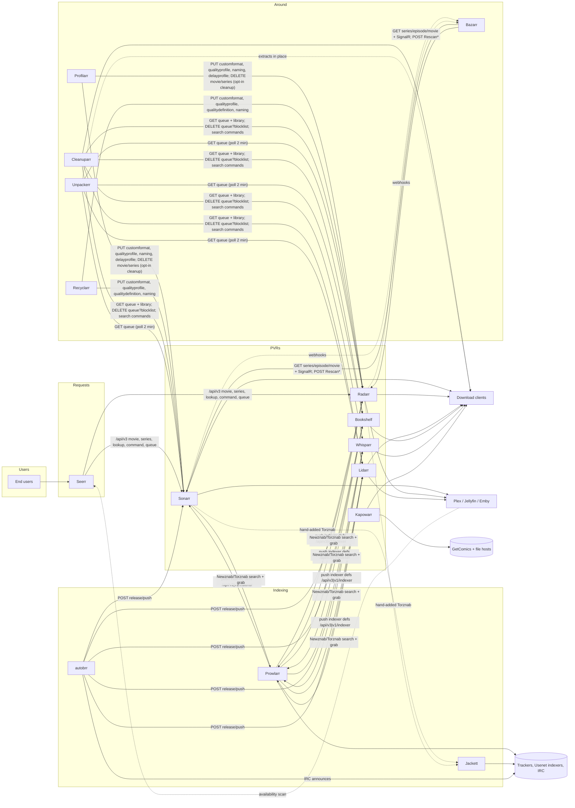

# Cross-App Comparison: the *arr Ecosystem

This document combines the 16 per-app reports in this folder:

| Group | Apps |
|---|---|
| **PVRs** (NzbDrone lineage) | [sonarr](sonarr.md), [radarr](radarr.md), [lidarr](lidarr.md), [bookshelf](bookshelf.md), [whisparr](whisparr.md) (v2), [whisparr-eros](whisparr-eros.md) (v3) |
| **PVR, independent** | [kapowarr](kapowarr.md) |
| **Indexers** | [prowlarr](prowlarr.md), [jackett](jackett.md), [autobrr](autobrr.md) |
| **Profiles** | [profilarr](profilarr.md), [recyclarr](recyclarr.md) |
| **Around the PVRs** | [seerr](seerr.md), [bazarr](bazarr.md), [cleanuparr](cleanuparr.md), [unpackerr](unpackerr.md) |

It covers:
- how the apps interact today (§1);
- duplicated or redundant functionality (§2);
- outdated functionality (§3);
- what a monolith makes unnecessary (§4);
- hard constraints (§5);
- code worth reusing (§6);
- rough sizing (§7).

Open decisions are tracked in [../decisions.md](../decisions.md).

The claims here were verified against the code and external sources on 2026-09-27 and corrected where needed; the evidence is in [../verification/](../verification/).

Line counts are rough, taken from the per-app reports and re-measured on 2026-09-27 (git-tracked, non-test files, blank lines included) unless noted. File paths are relative to each submodule.

---

## 0. The apps at a glance

| App | Role | Stack | Lineage | Backend size | License | Health |
|---|---|---|---|---|---|---|
| Sonarr | TV | .NET 10, React 18/TS (Vite, react-query, zustand) | NzbDrone original (2011) | ~155k C# (Core 112k, API v3+v5 21k) | GPL-3.0 | Active, the most modern of the forks |
| Radarr | Movies | .NET 8, React 18 (Redux → TS, mid-migration) | Sonarr fork | ~133k (Core 101k) | GPL-3.0 | Active |
| Lidarr | Music | .NET 8, React (~82% JS, Redux) | Sonarr fork (2017) | ~120k (Core 95k) | GPL-3.0 | Active; its metadata server is fragile |
| Bookshelf | Books and audiobooks | **.NET 6 (end of life)**, React 17/Redux | Sonarr → Lidarr → Readarr → Bookshelf | Core ~91k | GPL-3.0 | Light fork: about 35 commits since Readarr was archived (2025-06-27) |
| Whisparr (v2) | Adult | .NET 10, React 18 + Redux | Sonarr fork, ports Sonarr commits in batches | Core ~91k (only ~45 files unique) | GPL-3.0 | Active. Still maintained, not deprecated |
| Whisparr v3 (Eros) | Adult | .NET 10, React 19 + react-query/zustand (no Redux), webpack | Radarr fork, cherry-picks with a tracked decision per upstream commit; **0 commits behind Radarr**; frontend shares Sonarr's zustand/react-query direction, but on React 19 and webpack | ~58% of Core files identical to Radarr after renaming; 157 unique files | GPL-3.0 | Active: 21 stable releases (2026-01 to 2026-09, irregular), one main maintainer. No migration from v2 |
| Kapowarr | Comics | Python/Flask, vanilla JS | Independent | ~28k Python | GPL-3.0 | Active, single maintainer |
| Prowlarr | Indexer manager/proxy | .NET 8, React 17 (~74% JS) | Sonarr v3 fork | ~108k (Core 82k) | GPL-3.0 | Active |
| Jackett | Indexer proxy | .NET 9 **and** .NET Framework 4.7.1 (Mono), jQuery UI | Original Cardigann C# port | ~45k C# + 563 YAML | **GPL-2.0-only** | Active; upstream of Prowlarr's definitions |
| autobrr | IRC announce grabber | **Go 1.27**, React/TS | Independent | ~57k Go + 31k TS | GPL-2.0-or-later | Active, well tested |
| Profilarr | Profile/CF authoring + sync | Deno + SvelteKit, optional .NET parser | Independent (v2 rewrite, 2025) | ~81k TS + 48k Svelte | **AGPL-3.0** | Active |
| Recyclarr | TRaSH Guides → Arr sync CLI | .NET 10 CLI | Independent | ~20k C# | MIT | Active |
| Seerr | Requests and discovery | Express 5 + Next.js 16 / React 19, TypeORM | Overseerr + Jellyseerr merge | ~43k server + 52k UI | MIT | Active (Overseerr archived) |
| Bazarr | Subtitles | Python + React 19/Mantine | Independent | ~25k own + 22k providers (+1.3M vendored) | GPL-3.0 | Active |
| Cleanuparr | Queue hygiene | .NET 10 + Angular | Independent | ~48k C# (excluding ~137k lines of generated EF migrations) | GPL-3.0 | Active |
| Unpackerr | Archive extraction | **Go**, Svelte 5 UI | Independent | ~20k Go | MIT | Active |

Across the set there are about **1.27M lines of first-party backend code** (non-test) in C#, Python, TypeScript and Go, of which the seven NzbDrone forks are about 890k. There are also about 860k lines of frontend (JS/TS/Svelte, non-test) in **six different UI stacks**:
- React/Redux (several vintages)
- React Query
- Svelte
- Angular
- jQuery
- vanilla JS

---

## 1. How they interact today

### 1.1 Who calls whose API

All calls go to the Arrs, except Seerr's and Bazarr's calls to media servers. In the other direction, Sonarr and Radarr push webhooks to Bazarr (`webhooks/sonarr`, `webhooks/radarr`), and Plex can too.

| Consumer | Sonarr/Radarr (`/api/v3`) | Lidarr/Bookshelf (`/api/v1`) | Whisparr (`/api/v3`) | Notable quirks |
|---|---|---|---|---|
| **Prowlarr** | `indexer` CRUD, `indexer/schema`, `indexer/test`, `system/status` | same | same | `forceSave` retry; `"(Prowlarr)"` names; the 3-digit id regex bug (affects only rediscovery of lost mappings for remote ids ≥1000, which then get re-added as duplicates) |
| **Profilarr** | `customformat`, `qualityprofile`, `qualitydefinition/update`, `config/naming`, `config/mediamanagement`, `delayprofile/1`, `tag`, `command`, `release`, `rename`, `movie`/`series` editor, `log`, `health`, `DELETE movie/{id}` / `series/{id}`, `moviefile`/`episodefile`, `episode`, `queue?pageSize=200` (one page, no paging) | – (Lidarr/Chaptarr client classes exist but sync doesn't use them) | – | Matches by name; full-replace PUT; zeroes the scores of unmanaged CFs in the profiles it syncs. Its cleanup job (**opt-in**, weekly, Radarr/Sonarr only) deletes unmanaged CFs/QPs by name, and its "entity cleanup" deletes movies/series whose ids it parses out of the Arrs' `RemovedMovieCheck`/`RemovedSeriesCheck` health-message **text** |
| **Recyclarr** | `customformat`, `qualityprofile` (+schema), `qualitydefinition` (+update), `config/naming`, `config/mediamanagement`, `language`, `system/status` | – | – | Keeps a state file mapping `trash_id` to Arr ids; preserves unmanaged scores by default (`reset_unmatched_scores` is opt-in); deletes CFs only if `delete_old_custom_formats` is set, and only those in its own state |
| **Seerr** | About 20 operations: `system/status`, `qualityProfile`, `rootfolder`, `tag`, `movie`, `series` (GET/POST, **PUT with the id in the body**, DELETE), `*/lookup`, `episode`, `episode/monitor`, `queue`, `command`, `PUT tag/{id}`, `languageprofile` (Sonarr v3 and older) | – | – | `?apikey=` query auth. **Sends no `pageSize` on the queue, so it only sees 10 items.** Reads the Sonarr major version and calls `languageprofile` only for v3 and older; it does not require v4 |
| **Bazarr** | `series`, `episode`, `episodeFile`, `movie`, `tag`, `rootfolder`, `filesystem`, `history`, `languageprofile` (v3), `command Rescan*`, MediaCover, **SignalR `/signalr/messages`** | – | – | `?apikey=` query auth with TLS verification off (SignalR uses `?access_token=`); three SignalR client classes (legacy Sonarr, Sonarr, Radarr); hourly full sync by default (configurable); still has Sonarr v2 and Radarr v0.x code paths. Also receives webhooks from the Arrs |
| **autobrr** | `release/push`, `series`/`movie`, `tag`, `system/status` | `release/push`; `album`/`artist` (Lidarr, no `tag` call); `book`, `tag` (Readarr/Bookshelf) | `release/push`; `series` (v2) and `movie` (v3) | Sends `indexerFlags` only on Sonarr, Radarr and Sportarr pushes, using two bitmaps (Radarr-style, and Sonarr-style reused by Sportarr); Lidarr, Readarr/Bookshelf and Whisparr pushes carry none |
| **Cleanuparr** | `queue` (paged, 200/page), `DELETE queue/{id}?blocklist&skipRedownload&removeFromClient&changeCategory`, `command` (searches, `ManualImport`), `manualimport`, `history`, and for the Seeker the whole library: `movie`, `moviefile`, `series`, `episode`, `episodefile`, `qualityprofile`, `tag` (it computes missing/cutoff-unmet itself; no `wanted/*` calls) | `queue`, `DELETE queue` | same (separate v2 and v3 clients) | Matches the Arrs' `statusMessages` **text**; `X-Api-Key` header auth |
| **Unpackerr** | `queue` (up to 2,000 items; the page size is set inside `golift.io/starr`, not vendored) | `queue` | Supported as a Radarr instance named "Whisparr" (a clean fit only for v3) | Matches by title; infers an import happened when the item leaves the queue; `X-Api-Key` header via `golift.io/starr` |
| **Kapowarr** | – | – | – | No integration with any Arr |
| **Jackett** | – (the Arrs call it) | – | – | All six PVR forks warn on its `/all` endpoint (`IndexerJackettAllCheck`); Sonarr/Radarr's Torznab code also has Jackett-specific handling |

The "Whisparr" column hides two generations, both on `/api/v3`: the `whisparr` submodule is v2 (Sonarr-based: series/episodes) and `whisparr-eros` is v3 (Radarr-based: movies). autobrr and Cleanuparr handle both.

Consumers differ in ways any compatibility façade has to absorb:
- **Auth:** Seerr and Bazarr use `?apikey=`, Bazarr's SignalR uses `?access_token=`, and Cleanuparr and Unpackerr use the `X-Api-Key` header.
- **Queue paging:** Seerr gets the implicit 10, Profilarr one page of 200 (the same class of bug), Cleanuparr pages at 200, and Unpackerr caps at 2,000.

Integrations with apps outside the 16: Prowlarr syncs to LazyLibrarian and Mylar; autobrr and Cleanuparr support Sportarr, and Unpackerr documents it as Sonarr-compatible; Cleanuparr integrates LazyLibrarian; Profilarr has a Chaptarr client.

Third-party consumers outside this set (checked by cloning each consumer on 2026-09-27; see [../verification/decision-premises.md](../verification/decision-premises.md) §D7):
- **Sonarr/Radarr `/api/v3`:** Overseerr's successors, Maintainerr, Homepage, LunaSea (archived), nzb360 (closed source, unverified), Notifiarr (via `golift.io/starr`), nzbToMedia and download-client post-processing scripts (`Downloaded*Scan` commands), Requestrr, Doplarr (archived) and Home Assistant.
- **Lidarr/Bookshelf `/api/v1`:** Homepage, Notifiarr, nzbToMedia (`DownloadedBooksScan`, Lidarr `command`) and Home Assistant; LunaSea and Requestrr for Lidarr.
- **Seerr's own `/api/v1`:** Maintainerr, Requestrr/Doplarr (the only ones that send `X-API-User`), Homepage, mobile apps and Home Assistant.
- **Not consumers:** Tautulli (other tools call it) and Kavita (Bookshelf notifies it).

### 1.2 Structural observations

1. **Four apps keep their own mirror of the Arrs' libraries:** Seerr (availability), Bazarr (full series, episode and movie tables), Cleanuparr (queue reconstruction, the full library for its Seeker, and per-movie/per-episode custom-format scores with history) and Profilarr (library cache for upgrades). Each one polls, syncs and reconciles. autobrr's lists are not a mirror: they pull titles on a cron into a filter's `Shows` field. Cleanuparr is a fourth reader of CF scoring, alongside Profilarr, Recyclarr and the Arr itself.
2. **Three apps push configuration into the Arrs.** Prowlarr pushes indexers, and Profilarr and Recyclarr push profiles. Profilarr and Recyclarr **fight each other** when pointed at the same instance: last writer wins, and Profilarr zeroes the other tool's scores whenever it syncs a profile. Profilarr's cleanup deletes the other tool's objects only if that opt-in job is enabled; Recyclarr zeroes Profilarr's scores only with `reset_unmatched_scores` (see [recyclarr.md](recyclarr.md) §9). With cleanup enabled, Profilarr also **deletes media**: movies and series named in the Arrs' "removed from TMDB/TVDB" health messages. It is the most destructive cross-app call in the set.
3. **Two apps patch gaps in the Arrs' download handling:**
   - Cleanuparr covers stalled and slow downloads, malware, seeding, orphans and backlog search.
   - Unpackerr covers extraction of archived torrent downloads.

   Both infer state from the outside, by matching status text or titles. Profilarr's entity cleanup does the same with health-check message text.
4. **Users run multiple instances of the same app** to work around the one-file-per-item limit:
   - 4K and 1080p Radarr/Sonarr pairs, linked by instance-to-instance import lists and Seerr's `is4k` servers;
   - ebook and audiobook Bookshelf pairs.
5. **Everything relies on hosted services:**
   - Servarr proxies: SkyHook and `services.sonarr.tv`, `api.radarr.video`, `api.lidarr.audio`, `api.whisparr.com`, and `auth.servarr.com`;
   - community services: `bookinfo.pro`, `indexers.prowlarr.com` and `api.autobrr.com`.

---

## 2. Duplicated or redundant functionality

### 2.1 Infrastructure, rebuilt nine or more times

**The NzbDrone skeleton exists in seven copies** (Sonarr, Radarr, Prowlarr, Lidarr, Bookshelf, Whisparr v2, Whisparr v3), at different vintages:

| Subsystem | Copies | Vintage spread |
|---|---|---|
| `NzbDrone.Common` (HTTP client, disk, process, cache, OAuth1) | 7 | .NET 6 (Bookshelf) → .NET 10 (Sonarr, Whisparr) |
| ThingiProvider, Datastore, Messaging/command queue, Jobs, Housekeeping, HealthCheck, Backup, Update + updater exe, Auth, SignalR, Host/Windows/Mono | 7 | Only Sonarr has OIDC and an API v5 |
| React frontend scaffolding | 7 | Sonarr is TS/Vite/react-query; Lidarr and Bookshelf are 80%+ JS/Redux/react-router 5 |
| Migration histories | 7 (migration files: Sonarr 226, Radarr 140, Prowlarr 43, Lidarr 81, Bookshelf 42, Whisparr v2 32, Whisparr v3 36) | Whisparr v2's are renumbered and incompatible with Sonarr's. Both Whisparrs jump ids (v2: 1–18 then 202–221; v3: 1–26 then 236–245), so their highest ids (221, 245) overstate their size |

The same concerns are **re-implemented independently** in the other nine apps:

| Concern | Reimplemented in |
|---|---|
| Auth (users, sessions, API keys, OIDC) | Profilarr (bcrypt, scoped keys, OIDC), Seerr (Plex/Jellyfin/Emby/local), Bazarr (MD5 hashing, off by default), autobrr (argon2id, OIDC), Cleanuparr, Unpackerr (roles), Kapowarr (off by default), Jackett (SHA-512) |
| Scheduler / job queue | Profilarr, Seerr, Bazarr (APScheduler), autobrr (cron), Cleanuparr (Quartz), Kapowarr, Unpackerr |
| Notifications | Profilarr (4), Seerr (10, with per-user routing), Bazarr (Apprise), autobrr (9), Cleanuparr, Unpackerr (webhook) |
| Settings, backup, logs, updater, health | Every app |
| Separate SQLite and Postgres migration trees | Seerr (55/20), autobrr (99/89), Cleanuparr (3 EF contexts). The forks and Prowlarr use one FluentMigrator tree with `IfDatabase` branches |

**Estimate:** at least 150–200k lines of backend code (and a similar amount of frontend) are infrastructure repeated across the set. Measured: the seven forks' infrastructure directories alone total about 285k lines, so about 240k is redundant; this is a lower bound. A monolith builds each concern once.

### 2.2 Provider implementations

**Download clients:**
- Implemented in each fork (17–20 each, 18 in Prowlarr), in autobrr (Go libraries for qBittorrent, Deluge and rTorrent, plus Transmission, Porla, SAB and NZBGet), in Cleanuparr (qBittorrent, Transmission, Deluge, µTorrent, rTorrent) and in Kapowarr (qBittorrent, Transmission).
- About **15 distinct clients** remain after removing duplicates and dead ones (§3).
- autobrr's Go libraries are candidates for direct reuse (§6).

**Indexers:**
- **Prowlarr** has 68 native indexer classes (65 without the generic Cardigann/Newznab/Torznab; 11 are `[Obsolete]`) plus 557 Cardigann YAML definitions (v11).
- **Jackett** has 65 natives plus 563 YAML. 504 of the definitions are byte-identical to Prowlarr's (git blob equality); **Jackett is upstream.**
- **autobrr** has 118 announce definitions (115 with an IRC block; the other 3 are generic Newznab/RSS/Torznab) for the **same trackers** (BTN, PTP, RED, OPS, GGn, HDB, …).
- Native trackers inside the forks: Sonarr (BTN, HDBits, IPT, TL, FileList, Nyaa), Radarr (+PTP), Lidarr (Gazelle/Redacted/Orpheus), Bookshelf (MyAnonaMouse).
- Kapowarr adds a **third protocol**: direct-download scraping of GetComics. It also sends GetComics magnet links to qBittorrent or Transmission, but has no torrent indexer.
- **One indexer entity with `{search, rss, irc, api, ddl}` capabilities replaces all of these** (see [autobrr.md](autobrr.md) §11.3).

**Notifications:** the union is about 30 services.
- The forks each carry 25–27 (Prowlarr 20), mostly the same set.
- Seerr adds WebPush and **per-user targets**.
- Bazarr uses Apprise, which covers about 100 services.
- Profilarr, autobrr, Cleanuparr and Unpackerr add their own events.
- The monolith needs **one notification system with user-scoped routing** and the union of events, covering grab, import, upgrade, request, issue, subtitle, sync, drift, IRC, extraction and health.

**Media-server clients** (Plex, Jellyfin/Emby, Kodi) exist in the forks (library refresh), in Seerr (auth, user import, availability scans, watchlist) and in Bazarr (on-play webhook, refresh). **One client per server** should serve all these roles.

**Metadata clients:**
- TMDb is used by the Radarr proxy, Seerr (full discovery, with a hard-coded key) and Profilarr (entity testing). Radarr and Whisparr v3 also call TMDb directly for TMDb import lists, with the same hard-coded bearer token.
- TVDB is used by Sonarr's SkyHook and by Seerr directly.
- The others are MusicBrainz (via Lidarr's server), books (rreading-glasses), ComicVine and ThePornDB/StashDB (via Whisparr's proxy; Whisparr v3 also calls `stashdb.org/graphql` directly with a user-supplied key for StashDB import lists).
- IMDb ratings are proxied through `api.radarr.video`, even by Seerr.

**Import lists:**
- The Plex watchlist exists in **seven copies of three designs**: a Plex API list and a Plex RSS list in each of Sonarr, Radarr and Whisparr v2, plus Seerr's sync (with auto-request).
- Trakt appears in Sonarr and Radarr. Instance-to-instance lists appear in Sonarr, Radarr, Lidarr, Bookshelf and Whisparr.
- autobrr has its own lists: Trakt, MDBList, AniList, Steam and plaintext.

### 2.3 Domain logic duplicated across apps

| Concern | Where it exists today | Monolith target |
|---|---|---|
| **Release-name parsing** | Sonarr (142 ordered regexes, 1,631 tests), Radarr (movie cascade, editions), Lidarr (album/discography + fuzzy artist match), Bookshelf (title/subtitle split), Whisparr (dates, product codes), Profilarr (partial C# port), Bazarr (**guessit**, Python), autobrr (**rls**, Go, multi-media), Kapowarr (comic filenames) | One Go parser package with a sub-parser per media kind, validated against the combined golden corpora. Evaluate `rls` as the base (§6). |
| **Identification by tags/fingerprint** | Lidarr (a beets port: distance, Munkres, AcoustID) and Bookshelf (Lidarr's distance framework with ISBN/ASIN weights, but no Munkres or AcoustID) | One distance-based matcher with per-kind candidate sources and weights |
| **Media probing** | Sonarr/Radarr (ffprobe), Bazarr (knowit/ffprobe, a second probe of the same file), Lidarr/Bookshelf (TagLib) | One probe per file, shared by quality, custom formats and subtitles |
| **Quality model** | Sonarr (Source × Resolution), Radarr (+ Modifier, CAM…Remux), Lidarr (codec × bitrate × bit depth, 38 qualities), Bookshelf (ebook + audio formats in one ladder), Whisparr (+VR), Profilarr (canonical names + per-app mapping) | A canonical quality model with **per-media-kind axes** |
| **Languages** | Sonarr (54), Radarr (60, including Unknown/Any/Original), Lidarr (vestigial, 34), Bookshelf (ISO-639-3), Bazarr (ISO + hearing-impaired/forced + custom codes), Profilarr (59, using Radarr's ids). **Integer ids differ per app:** 15 of the 50 names Sonarr and Radarr share have different ids. | One ISO-639-based language type with flags |
| **Custom formats / filters** | Sonarr (8 spec types), Radarr (10), Lidarr (4), Profilarr's evaluator (11), **autobrr filters** (about 80 fields, including uploader, freeleech, log/cue) | One condition engine: the union of spec types plus announce-metadata specs, used by profiles **and** "autograb rules" |
| **Profile sync** | Profilarr (name-matched, destructive) and Recyclarr (id-mapped, non-destructive) | Gone: the profile store *is* the configuration. Keep both as **importers** (TRaSH primary, PCD secondary). |
| **Download tracking policy** | Arrs (import states, `AutoRedownloadFailed`, dangerous-extension check), **Cleanuparr** (stalled, slow, metadata, malware, seeding, orphans, dead torrents, unlinked), **Unpackerr** (extraction) | One tracked-download state machine with time-based policies, an `Extracting` stage, a file-content policy and a seeding manager |
| **Backlog / upgrade search** | Arrs (manual bulk only), Cleanuparr's Seeker (throttled trickle), Profilarr's upgrades (filter DSL + tag cooldowns) | One backlog scheduler that knows the indexer budget, with Profilarr's filter DSL as the selector |
| **Availability** | Arrs (they have the files), **Seerr** (four scanners (Plex, Jellyfin, Sonarr, Radarr) + daily availability sync, each field duplicated for 4K) | A query: item → files, per version slot |
| **Subtitle index** | Arrs (`SubtitleFiles`/`ExtraFiles`) and **Bazarr** (`table_*_subtitles`), for the same files | One extra-files table; subtitle state keyed to the media file |
| **Request / "wanted" intent** | Seerr (requests), import lists (auto-add), autobrr lists (copies of what's monitored) | Requests become a user-facing layer over "monitored" in the same database |
| **Delay / hold** | Arr delay profiles (minutes, per protocol) and the autobrr filter delay (seconds, lost on restart) | One persisted delay mechanism |
| **Rate limits** | Prowlarr (per host + query/grab limits from history), autobrr (`max_downloads`), Cleanuparr (search throttle), Kapowarr (ComicVine batches), Bazarr (per-provider throttles) | One rate-limit/budget service |
| **Cloudflare / FlareSolverr** | Prowlarr (tag-scoped proxy), Jackett (global), Kapowarr (FlareSolverr/Byparr), Bazarr (cloudscraper + js2py) | One HTTP-layer capability |
| **Naming tokens** | Every PVR, plus Profilarr's `namingTokens.ts` duplicate | One token engine with per-kind token sets |

### 2.4 What genuinely differs per media kind

| Kind | Container → item → file | Unique logic to keep | Metadata |
|---|---|---|---|
| TV | Series → Season → Episode ← EpisodeFile (multi-episode files) | Scene/XEM numbering, anime absolute numbering, daily series, specials placement, season packs | TVDB / TMDb (SkyHook today) |
| Movies | Movie (+ shared Metadata) ← MovieFile | Availability (cinema/digital/physical), collections, editions, translations, profile language | TMDb |
| Music | Artist → Album (release group) → AlbumRelease → Track ← TrackFile (**absolute paths, many tracks per file, unmapped files**) | Metadata profiles (primary/secondary types, statuses), beets-style identification + AcoustID, tag writing, album-level import | MusicBrainz (Lidarr server today) |
| Books | Author → Book (work) → Edition ← BookFile (many files per edition, e.g. multi-file audiobooks) | Metadata profiles (popularity, language, ISBN), ISBN/ASIN identification, EPUB/MOBI/PDF/m4b tags, Calibre, ebook + audiobook together | Hardcover / OpenLibrary / rreading-glasses; Audnexus for audiobooks |
| Adult | v2: Site → (year) → Scene. **v3:** Scene or Movie item (`ItemType`) with Studio and Performer entities, both monitorable with an `AfterDate` cut-off | Date-first parser, same-date matcher by title and performers (v3 adds a fuzzy match that breaks v2's reject-if-ambiguous rule), product codes (v3 lost the index and the code-based completed-download fallback; its title matching still tries the code), query templates, performer/studio-driven monitoring | StashDB / ThePornDB / TMDb (both versions get metadata through `api.whisparr.com` today; v3's import lists also call StashDB and TMDb directly) |
| Comics | Volume → Issue ← File (**M:N**, fractional/range numbers, TPB/one-shot/omnibus) | Special-version inference, coverage planner, CBZ conversion, ComicInfo.xml | ComicVine (per-user key) |
| Subtitles | Attached to a video **file** | Scoring (episode max 360, movie max 180), hearing-impaired/forced semantics, provider throttles, sync (ffsubsync/alass), mods | About 65 provider modules; ~50–55 offered in the UI |
| Requests | User → Request → media item (seasons) | Permissions, quotas, approvals, issues, media-server identity | TMDb discovery |

Everything else is one pipeline for every kind:
- **monitor** → **search / RSS / IRC / DDL** → **decide** → **grab** → **track** (+ policies) → **extract** → **import / identify** → **rename / tag** → **subtitles** → **notify / refresh media servers** → **seed / clean up**.

---

## 3. Outdated functionality

These are consolidated from all 15 reports; evidence is in §10 of each, and re-checked in [../verification/outdated-and-security.md](../verification/outdated-and-security.md). Apps marked in the "Apps" column carry the item. "Six forks" means Sonarr, Radarr, Lidarr, Bookshelf, Whisparr v2 and v3; Prowlarr, built from the same tree, carries most of the same items.

### 3.1 Dead services, apps and protocols (drop)

| Item | Apps | Reason |
|---|---|---|
| TVRage ids and `rid` search | Sonarr, Bookshelf, Prowlarr, Jackett (Cardigann `.Query.TVRageID`) | Offline from 2015, gone for good by 2016 |
| Torcache interceptor | six forks + Prowlarr | Dead since 2016 |
| EZRSS parser | six forks + Prowlarr | Dead |
| Fanzub | Sonarr, Whisparr | Dead |
| CouchPotato / TorrentPotato (indexer, import list, Jackett's `/potato/` API) | Radarr, Prowlarr, Jackett | CouchPotato is dead |
| Headphones (VIP indexer, import list) | Prowlarr, Lidarr | Niche. Not dormant: v0.6.4 released 2025-07-01 (the VIP indexer service wasn't checked) |
| Goodreads API: 4 import lists, 2 notifications, hard-coded keys | Bookshelf | API retired in 2020 |
| Readarr updates on `readarr.servarr.com` (`api.bookinfo.club` is already replaced by `api.bookinfo.pro`) | Bookshelf | Readarr retired; the bookinfo.club domain lapsed around Aug 2024 |
| Readarr as a sync target | Prowlarr, autobrr, Cleanuparr, Unpackerr | Retired; Bookshelf replaces it |
| 11 `[Obsolete]` native indexers (e.g. Rarbg, BinSearch), UNIT3D base class, `IndexerDefinitionVersion` | Prowlarr | Self-declared (the BinSearch site itself is still up) |
| AHD indexer flags, PTP old-settings check | Radarr (AHD flags also in Whisparr v3) | Tracker gone; one-time nag |
| Hadouken, Vuze, Pneumatic clients | six forks + Prowlarr | Projects dead |
| uTorrent client | six forks + Prowlarr, Cleanuparr | Not dead: legacy and ad-supported, but still shipped (Windows 3.6.0 builds) and used. Low priority rather than drop |
| Legacy client API paths: NZBGet v12/13, qBittorrent API v1, Synology DS v1, Deluge v1 | six forks + Prowlarr, autobrr (Deluge v1) | Ancient versions. The clients themselves are alive (NZBGet via nzbgetcom, Synology Download Station 4.1.0) |
| Twitter notification + the OAuth1 library | six forks + Prowlarr | X API v1.1 is gone; posting via v2 is pay-per-use only for new developers since 2026-02-06 |
| LunaSea agent | Seerr (removed), autobrr | App archived (2025-04-03) |
| Roksbox, WDTV metadata | Sonarr, Radarr, Lidarr, Whisparr v2 and v3 | Dead devices |
| Emby (Legacy) and Kometa metadata writers | Radarr, Whisparr v3 | Self-declared deprecated (Emby and Kometa themselves are alive) |
| Plex legacy response models and legacy Plex agents | six forks, Seerr | Old Plex Media Server versions |
| Jackett "/all" checks | six forks | Moot once indexing is internal |
| CloudFlare captcha interceptor and UI flow | six forks + Prowlarr | FlareSolverr replaces it |
| Socks4 | six forks + Prowlarr, Jackett | Legacy but still widely supported; low priority rather than dead |
| Dead subtitle providers: hosszupuska and subscenter (still listed in the UI); shooter, argenteam, legendastv and thesubdb (backend or `custom_libs` only) | Bazarr | Sites dead. nekur, subsynchro and yifysubtitles are alive and wizdom is unclear, so they are not in this list |
| Hard-coded public trackers in synthesised magnets; torrentgalaxy avoid-list | Kapowarr | Dead trackers |
| autodl-irssi config importer | autobrr | autodl-irssi is dead |
| Magnetico native | Jackett | Abandoned upstream |

Only the legacy code paths are obsolete for integrations that are still alive: Emby, Kometa, BinSearch, Synology Download Station, Prowl, Pushbullet (maintenance mode), NZBVortex, Headphones and uTorrent. Don't drop these integrations wholesale.

### 3.2 Legacy compatibility paths (drop)

- **Sonarr v2/v3 and Radarr v0.x/v2 client code** in consumers:
  - Bazarr: about 13 `is_legacy` conditionals (15 occurrences) and a classic SignalR client.
  - Seerr: language profiles, `profileId`.
  - Recyclarr: `:4` naming keys.
  - Prowlarr: a "Sonarr v2" validation message (a string, not a code branch).
- **Sonarr's deprecated v3 API layer**, its `ObsoleteQueueService`, and language-profile stubs in Sonarr and Whisparr.
- **Old Profilarr and Recyclarr keys and commands:** Profilarr's v1-era language types, `on_change`, `should_sync` and the legacy `jobs` tables. Recyclarr's `state repair`, `migrate`, and the config keys deprecated in its v5.0, v8.0 and v9.0 upgrades.
- **The Overseerr/Jellyseerr merge machinery** in Seerr (`overseerrMerge.ts`, the status remap, the `JELLYFIN_TYPE` variable, `jellyfin*` columns used for Emby).
- **Jackett's .NET Framework 4.7.1 / Mono build**, ASP.NET Core 2.x packages, and legacy routes.
- **Sonarr leftovers in the forks:**
  - Radarr: `EpisodeFormat`.
  - Lidarr: TV regexes, mig 067.
  - Bookshelf: Lidarr music naming everywhere.
  - Whisparr: anime/scene/season code that it never uses.

### 3.3 Platform history (drop)

- **Windows desktop and service code:** tray apps, service installer executables, firewall COM, `RegisterUrl`, Inno Setup (six forks + Prowlarr + Jackett), Unpackerr's desktop tray and zenity dialogs.
- **Mono and runtime workarounds:**
  - `NzbDrone.Mono` naming (six forks + Prowlarr) and Mono.Posix (Bookshelf, Lidarr, Prowlarr, Radarr, Whisparr v3, Jackett; Sonarr and Whisparr v2 use `Openur.Mono.Unix`).
  - Harmony runtime patches (Sonarr, Whisparr v2).
  - `LongPathSupport`.
  - The legacy AppData migration (all forks except Bookshelf, plus Prowlarr).
- **Self-updaters:** six fork updaters, Bazarr (unzips over the install), Jackett's updater, Unpackerr's update check and re-exec.
- **Python 2 compatibility and abandoned JavaScript engines:** Bazarr's js2py (115k lines; unmaintained since 2022, with an unpatched sandbox escape, CVE-2024-28397) and `future`/`six`/`past` (about 44k more), and Kapowarr's Python 3.8 shims.
- **End-of-life runtimes:** .NET 6 (Bookshelf), and Python 3.8 support (Kapowarr).
- **Library debt:** two JSON serializers, RestSharp 106 and FluentValidation 9 (five forks + Prowlarr; Whisparr v3 has upgraded), jQuery/moment/lodash, retry-go v3+v4, `pkg/errors` alongside autobrr's own.
- **Separate SQLite and Postgres migration trees** in three apps (autobrr, Seerr, Cleanuparr).

### 3.4 Insecure defaults and anti-patterns (don't repeat)

- **Auth off by default, or the API key handed out when no password is set:** Kapowarr, Jackett's open admin, and Bazarr (`auth.type` defaults to `None`).
- **Weak password hashing:** unsalted MD5 (Bazarr); one round of SHA-512 salted with the API key (Jackett), so anyone with the key can brute-force the password offline. Jackett's config DTO also sends the first 10 characters of the hash to the UI.
- **API keys in query strings:** Seerr and Bazarr towards the Arrs; Kapowarr accepts its own API key from the query or form; and the Arrs accept `apikey`/`access_token` query parameters. (Cleanuparr and Unpackerr send the `X-Api-Key` header; Cleanuparr uses the query string only for LazyLibrarian.)
- **TLS verification disabled:** Bazarr.
- **Telemetry on by default with hard-coded secrets:** Bazarr (GA4). Sentry DSNs in Sonarr, Radarr, Lidarr, Whisparr v2 and v3 (reusing Radarr's) and Prowlarr; Bookshelf has removed its DSN.
- **Hard-coded third-party API keys:** TMDb/TVDB (Seerr), AcoustID/Last.fm/Spotify client id/Headphones (Lidarr), Goodreads (Bookshelf), Rotten Tomatoes' Algolia key (Seerr), and the same TMDb bearer token in Radarr and Whisparr v3.
- **Lidarr loads arbitrary .NET plugin assemblies from GitHub:** it downloads them at runtime with no signature, hash or allow-list check and loads them in-process on restart. `AssemblyLoadContext` is not a sandbox.
- **Secrets stored in plaintext:** Profilarr (its AI key is commented "Encrypted", but there is no encryption code), Kapowarr, most others.
- **Unpatched bundled code:** Bazarr's js2py (CVE-2024-28397, see §3.3).

---

## 4. What a monolith makes unnecessary

These parts are not legacy. They exist only because the apps are separate processes.

| App | Disappears | Survives as a concept |
|---|---|---|
| **Prowlarr** | App sync (7 proxies, `AppIndexerMap`, the 6-hourly sync, the mapping regex), the internal Newznab XML round trip, encrypted proxy links, reverse DNS/UA source tracking, in-memory stats | Per-consumer category filters, the RSS/auto/interactive enable flags, seed criteria, query/grab limits, the Newznab server as an optional façade (§5.3) |
| **Jackett** | The whole app (Prowlarr supersedes the product model) | Definition feed as an optional overlay; `replaces` aliasing; result cache with TTL ≈ the RSS interval |
| **autobrr** | `release/push`, the six *arr clients, library lists, per-app flag bitmaps, webhook list refresh | IRC ingest as a release source; filters become "autograb rules" on the CF engine; racing (library-less) mode |
| **Profilarr** | Sync, drift, cleanup, Arr clients, the parser sidecar, evaluator, naming tokens, per-app enum mapping, the library cache, tag cooldowns | Profile schema, git-distributed packs with conflict-resolving overrides, the testing UX, the upgrade filter DSL |
| **Recyclarr** | State files, gateways, equivalence diff, adoption logic, cron (~70% of the code) | A TRaSH importer: `trash_id` as an external reference, score sets, CF groups, quality-size and naming presets, non-destructive defaults |
| **Seerr** | Remote Arr ids in settings and requests, lookup-then-POST/PUT, FAILED-on-network-error, the Arr scans, availability sync, queue polling, per-user Arr tags, 4K-as-second-server, the JSON settings file | Users, permissions, quotas, requests, approvals, issues (now linked to real files), discovery UI, media-server identity, watchlist auto-request |
| **Bazarr** | Mirrored series/episode/movie DB, three sync paths (SignalR with three client classes, webhooks from the Arrs, hourly full sync), path mappings, the `Rescan*` round trips, the duplicate subtitle index, the second media probe | Subtitle providers, scoring, language/hearing-impaired/forced semantics, subtitle sync, mods, translation, embedded-track handling |
| **Cleanuparr** | Queue reconstruction, the library and CF-score mirrors, strike tables and decay, text matching on `statusMessages`, `skipRedownload` + its own search queue, force-import caches, double polling, container path remapping | Time-based download policies, file-content policy, seeding manager, orphan housekeeping, backlog trickle search, private-tracker safeguards |
| **Unpackerr** | Queue polling, title-keyed tracking, "left the queue = imported" | An `Extracting` stage in tracked downloads, using the `xtractr` library |
| **Forks** | Instance-to-instance import lists (Sonarr→Sonarr and so on); second copies of everything in §2.1; native indexers in each PVR | – |

---

## 5. Hard constraints

### 5.1 .NET regex syntax is everywhere

The following all use .NET or Python regex features that Go's RE2 lacks:
- custom-format regexes (Dictionarry, TRaSH);
- Cardigann filters (`regexp`, `re_replace` and the `{{ re_replace }}` template; `validate` and `andmatch` are not regexes);
- the PVR parsers;
- Whisparr's product-code patterns;
- Bazarr's guessit/rebulk patterns.

Measured on 2026-09-27, the share of unique patterns that Go's RE2 rejects is: Dictionarry 87%, TRaSH 5.3%, Cardigann about 3.5%, Sonarr's parser 69%, Radarr's 36%. The blockers are lookarounds, backreferences, `\uXXXX` escapes and .NET named Unicode blocks (`\p{IsCyrillic}`). Named groups are not: Go accepts `(?<name>…)` since 1.22.

→ **D1** in `decisions.md`.

### 5.2 Hosted-service dependencies

| Service | Used by | Status |
|---|---|---|
| `skyhook.sonarr.tv`, `services.sonarr.tv` | Sonarr | Servarr-run. `services.sonarr.tv` also serves scene mappings, the daily-series list, the MyAnimeList OAuth relay, the update feed and health notices |
| `api.radarr.video` | Radarr, **Seerr** (IMDb ratings) | Servarr-run. Radarr also calls TMDb directly for import lists |
| `api.lidarr.audio`, `spotify.lidarr.audio` | Lidarr | Servarr-run. **No fallback:** only a URL override to another LidarrAPI-compatible server, not MusicBrainz itself. **Down from 2025-05-21** after a MusicBrainz schema change, still down with "no ETA" on 2025-06-26 ([MetaBrainz forum](https://community.metabrainz.org/t/for-those-using-lidarr-and-musicbrainz-metadata/768255)); a request for fallback servers was closed ([Lidarr#5558](https://github.com/Lidarr/Lidarr/issues/5558)) |
| `api.whisparr.com` (v2 `/v3`, Eros `/v4`) | Whisparr v2 and v3 | Whisparr-run, closed source. Eros's proxy appears to aggregate StashDB, ThePornDB and TMDb (inferred from ids; not checkable). Eros also calls `stashdb.org/graphql` (user key) and TMDb directly for import lists |
| `api.bookinfo.pro`, `hardcover.bookinfo.pro` (rreading-glasses) | Bookshelf | Advertised as the hosted instances in the rreading-glasses README (author `blampe`); the legal operator isn't named. About 12k daily users (Jan 2026) |
| `auth.servarr.com` | Sonarr (Trakt, AniList, Simkl), Radarr (Simkl, Trakt), Bookshelf (Goodreads signing), Whisparr v3 (Trakt) (OAuth relay). Lidarr's relay is `spotify.lidarr.audio`; Sonarr's MAL relay is `services.sonarr.tv` | Servarr-run |
| `indexers.prowlarr.com` | Prowlarr | Servarr-run; the repo has no license |
| `api.autobrr.com` | autobrr (list presets, update check) | autobrr-run |
| Update feeds | Sonarr (`services.sonarr.tv`); Radarr, Lidarr, Prowlarr, Whisparr (`*.servarr.com`); Bookshelf (still `readarr.servarr.com`); Whisparr v2/v3 and Bazarr (GitHub releases) | – |
| Sentry | Sonarr (`sentry.sonarr.tv`); Radarr, Lidarr, Prowlarr, Whisparr v2/v3 (`sentry.servarr.com`). Bookshelf has none | – |
| Google Analytics 4 | Bazarr (on by default) | – |
| `cleanuparr-status.pages.dev` | Cleanuparr (status polling) | Cleanuparr-run |

→ **D3** in `decisions.md`.

### 5.3 External contracts

Now that the consumers have been analysed, the contracts fall into three groups:
- **Consumers inside the monolith**, whose calls become in-process: Prowlarr, Profilarr, Recyclarr, Seerr, Bazarr, autobrr, Cleanuparr, Unpackerr. These no longer need the Arr APIs at all.
- **Consumers outside the set:**
  - Sonarr/Radarr `/api/v3`: Maintainerr, Homepage, LunaSea (archived)/nzb360, Notifiarr, nzbToMedia, Requestrr, Doplarr (archived), Home Assistant.
  - Lidarr/Bookshelf `/api/v1`: Homepage, Notifiarr, nzbToMedia, Home Assistant, Lidarr tooling. (Kavita is a notification target, not a consumer.)
  - The Newznab/Torznab server: Mylar, LazyLibrarian, anything else.
  - Apps outside the 16 that the absorbed tools integrate with: Sportarr, LazyLibrarian, Mylar, Chaptarr (§1.1).
  - Seerr `/api/v1`: Maintainerr, Requestrr/Doplarr, Homepage, mobile apps, Home Assistant.
  - Bazarr's API: dashboards.
- **Contracts with user-written code:** webhook payloads, `*_EventType` custom-script environment variables, Seerr's webhook template variables, the `Downloaded*Scan` commands.

→ **D7** in `decisions.md`.

### 5.4 Licensing

| License | Apps |
|---|---|
| GPL-3.0 | Sonarr, Radarr, Prowlarr, Lidarr, Bookshelf, Whisparr, Kapowarr, Bazarr, Cleanuparr |
| AGPL-3.0 | Profilarr |
| **GPL-2.0-only** | **Jackett** |
| GPL-2.0-or-later | autobrr |
| MIT | Seerr, Recyclarr, Unpackerr (+ `xtractr`), the original Go Cardigann (its author's own files only; see §6) |
| No license file | Prowlarr/Indexers (the definitions). 504 of its 557 v11 files are byte-identical to Jackett's, so they are still GPL-2.0 via Jackett; only Prowlarr's own changes have no stated license |

**Jackett's GPL-2.0-only** status taints the Cardigann lineage. Prowlarr's GPL-3.0 engine is derived from it (a shared FIXME comment, 142 verbatim lines, no attribution), and the definitions data is effectively Jackett's. "-only" is the conservative reading: Jackett ships just the GPLv2 text (GitHub's template) and states no version anywhere, so a GPLv2 §9 "any version" argument exists but isn't safe to rely on. Jackett's own engine began as a C# port of the MIT Go Cardigann.

Bazarr's vendored `libs/` mix GPL, LGPL and MPL licenses; this matters only if Python code is ported.

→ **D5** in `decisions.md`.

---

## 6. Reusable code (Go or permissively licensed)

| Component | Source | License | Use |
|---|---|---|---|
| IRC client, announce pipeline, 118 definitions (115 with IRC) + regex tests | autobrr `internal/irc`, `internal/announce`, `internal/indexer/definitions/` | GPL-2.0+ | Lift directly as the IRC release source |
| qBittorrent / Deluge / rTorrent clients | `autobrr/go-qbittorrent`, `go-deluge`, `go-rtorrent` (+ `go-torrent`, `go-cache`) | MIT, except `go-deluge`: GPL-2.0-or-later (compatible with GPL-3.0) | Torrent-client layer |
| Torznab/Newznab XML types and caps parsing | autobrr `pkg/torznab`, `pkg/newznab` | GPL-2.0+ | Newznab client base |
| Infrastructure idioms | autobrr: chi, scs, go-oidc/PKCE, argon2id, zerolog + trace id, `modernc.org/sqlite`, embed-FS migrator, pre-migration backup, typed event bus, `_FILE` secrets convention | GPL-2.0+ / permissive (MIT, BSD-3, ISC, Apache-2.0); autobrr's `sse` fork is MPL-2.0 | Adopt as house style |
| Release parser | `rls` (`github.com/autobrr/rls v0.8.1`, fork of `moistari/rls`) | MIT (fork and upstream) | Candidate base for the unified parser, pending the golden-corpus test. Pure RE2; 418 test cases, few for books and comics |
| Archive extraction | `golift.io/xtractr` | MIT (its dependencies are permissive, plus MPL-2.0 `golang-lru`) | `Extracting` stage |
| Cardigann engine seed | `cardigann/cardigann` (Go, 2020) | MIT for its author's files. It imports `cardigann/releaseinfo` (GPL-3.0, ported from Sonarr's parser) and `bcampbell/fuzzytime` (GPL-3.0-or-later), which are GPL-3.0-compatible but not permissive, and `cardigann/go-imdb-scraper` (no license) | Base for a fresh engine at the v11 schema: take only the author's files, replace `releaseinfo` with our parser, and drop `go-imdb-scraper` |
| Book metadata | `blampe/rreading-glasses` | GPL-3.0 (Go; "-only" vs "-or-later" unstated, compatible either way) | Embed or run as a sidecar behind a provider interface |
| Regex engine | `dlclark/regexp2` | MIT (parts ported from MIT `dotnet/corefx`; keep both notices) | .NET-compatible regexes (D1) |
| Golden test corpora | Sonarr/Radarr parser tests, Lidarr/Bookshelf identification fixtures, Profilarr CF tests, autobrr definition tests, Kapowarr filename tests | Various GPL | Port as behavioural specs |

Transitive dependencies of these libraries were not audited. Run `go-licenses` (or similar) over the final module graph before release.

---

## 7. Rough sizing of the consolidation

These are order-of-magnitude figures, not a plan.

| Bucket | Today | After consolidation |
|---|---|---|
| Duplicated infrastructure (seven NzbDrone copies + nine reimplementations) | ~240k+ (the seven forks' infrastructure alone is ~285k) | One copy, much smaller in Go |
| Six UI stacks | ~860k | One UI |
| Integration and sync layers (Prowlarr app sync, Profilarr sync/drift, Recyclarr state, Seerr/Bazarr/Cleanuparr/Unpackerr/autobrr Arr clients and mirrors) | ~50–80k (~45–50k by direct directory count, more with mirrored models elsewhere) | Gone |
| Forked PVR pipelines (download handling, import, CF, decision, queue, history, rename, providers) | ~6 × 54k ≈ 325k | One generic pipeline |
| **Irreducible domain logic:** TV parser + scene numbering; movie availability, collections and editions; music identification; book identification and metadata profiles; the adult date matcher; comic coverage planning; subtitle providers and scoring; the request/permission model; indexer engine + natives + IRC; the profile model + importers; download policies | ~150–200k across languages | Most of it survives. This is where effort and the ported golden tests go |
| Dead and legacy code (§3) | ~40k+ (plus 1.3M vendored Python) | Gone |

The measured totals are larger than the first estimates, so the monolith's reduction ratio is larger, not smaller.

The largest risks are:
1. **Parser fidelity:** the Sonarr and Radarr corpora, guessit parity for subtitles.
2. **Indexer engine fidelity:** Cardigann semantics must match what the definitions are tested against.
3. **Subtitle provider breadth:** about 50–55 providers offered, many of them scrapers.
4. **Metadata independence:** music, books and adult content all depend on proxies today.
5. **Licensing** of the Cardigann lineage.
