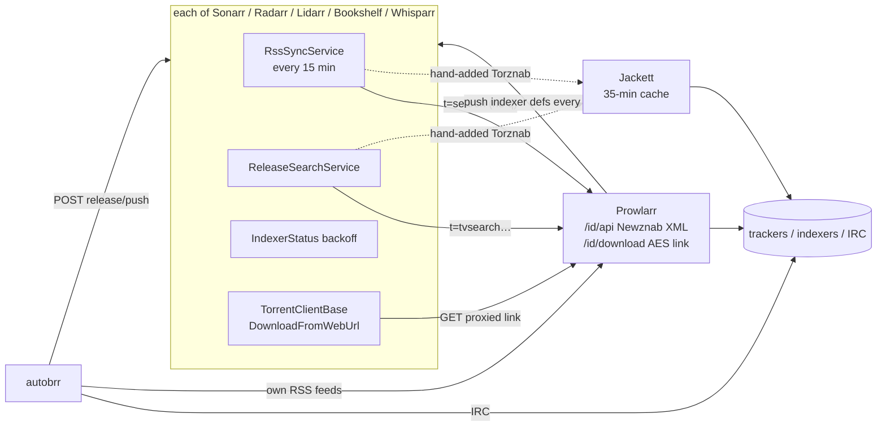
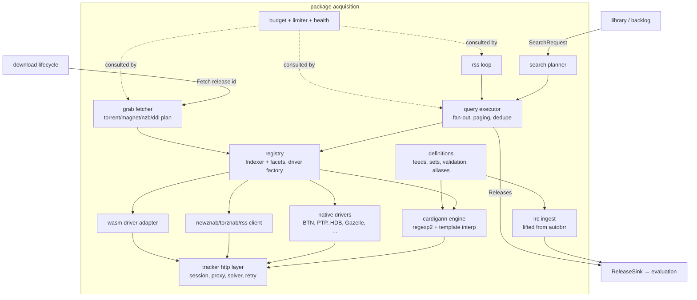

# Design: Acquisition Sources and the Indexer Layer

**Scope.** This document covers everything that turns the outside world (trackers, Usenet indexers, IRC announce channels, tracker APIs, and later DDL sites) into normalized **Release** objects, and fetches the payload for a release the rest of the system decides to grab. That means:
- the indexer entity and its facets;
- the Cardigann engine and definition lifecycle;
- native indexers and the generic Newznab/Torznab/RSS client;
- IRC ingest;
- search orchestration and the RSS loop;
- budgets, backoff and health;
- the HTTP layer (sessions, captcha, proxies, FlareSolverr);
- the grab fetch path;
- DDL as a protocol.

**Boundaries.** Other design areas own the following. This layer exposes interfaces to them (§3.17):
- deciding *what* to search (library, backlog scheduler);
- title parsing and deciding *whether* to grab (release evaluation, profiles, autograb rules);
- sending payloads to clients and tracking them (download lifecycle);
- the job queue, leader election and events (runtime/HA);
- the public API and auth.

**Governing decisions:**
- D1b: Cardigann regexes run on regexp2 with a timeout.
- D2: indexers (search, RSS and IRC) are in phase 1.
- D5b: a fresh Go Cardigann engine; definitions are fetched at runtime and never embedded.
- D7: no Newznab/Torznab server.
- D11: DDL in phase 3, as a third protocol.
- D14: HA.
- D15: WASM plug-ins.
- D16: secrets live in the DB; racing mode comes later.
- D19: redesign, don't replicate.

Paths are relative to `submodules/<app>/`. `SC/` = `sonarr/src/NzbDrone.Core/`, `PC/` = `prowlarr/src/NzbDrone.Core/`, `JC/` = `jackett/src/Jackett.Common/`.

---

## 1. Outcomes to preserve

These are the user-visible behaviours and correctness invariants. Everything else in the references is treated as implementation.

| # | Outcome / invariant | Evidence |
|---|---|---|
| **Sources** | | |
| O1 | A user can add any tracker or indexer covered by the Cardigann definition set (~557 v11 files) and have it search and RSS without code changes. | `PC/Indexers/Definitions/Cardigann/*`; `jackett.md` §3.1; `duplication-and-sizing.md` (557 v11 files) |
| O2 | API-based trackers with bespoke protocols work: BTN JSON-RPC, PTP, HDBits, AnimeBytes, MAM, Gazelle/Redacted/Orpheus, Avistaz family, FileList, BeyondHD. | `PC/Indexers/Definitions/*`; `SC/Indexers/{BroadcastheNet,HDBits,FileList}`; `lidarr.md` §4 (Gazelle/Redacted) |
| O3 | Generic Newznab and Torznab endpoints work, with remote caps discovery and a user override of categories. | `SC/Indexers/Newznab/NewznabRequestGenerator.cs`; `PC/Indexers/Definitions/Newznab/NewznabCapabilitiesProvider.cs`; `prowlarr.md` §3.5 (mig 040) |
| O4 | Plain RSS feeds (torrent RSS, IPT/TL cookie RSS) work as RSS-only sources. | `SC/Indexers/TorrentRss/`, `SC/Indexers/IPTorrents/` |
| O5 | IRC announces from ~115 private trackers are parsed within seconds and can lead to a grab. The connection features are preserved: NickServ/SASL, invite bots, bouncers, proxies, reconnect and flapping handling. | `autobrr/internal/irc/handler.go`, `state_machine.go`, `channel_state_machine.go`; `autobrr/internal/announce/announce.go`; `autobrr.md` §3.1 |
| O6 | When an announce lacks fields a rule needs (size, uploader, log score), they are filled from the tracker API or from the .torrent, and only when needed. | `autobrr/internal/filter/service.go:731`; `autobrr/internal/indexer/api.go` |
| **Search** | | |
| O7 | Search uses the most precise query an indexer supports: an id search (tvdbid → imdbid → tvmazeid → tmdbid) first, then a title search. A lower tier runs only if the higher one returned nothing. | `SC/Indexers/Newznab/NewznabRequestGenerator.cs:234-300` (`AddTier`); `SC/Indexers/HttpIndexerBase.cs:149-200` (`if (releases.Any()) break`) |
| O8 | TV search covers standard, daily, anime (absolute numbers, anime categories, `AnimeStandardFormatSearch`), specials and scene numbering. Season-vs-episode search is chosen per indexer by `SeasonSearchMaximumSingleEpisodeAge`. | `SC/IndexerSearch/Definitions/*.cs`; `SC/Indexers/IndexerDefinition.cs:32`; `SC/Indexers/Newznab/NewznabSettings.cs:79-82` |
| O9 | Music uses `t=music&artist&album`, falling back to `q=`. Books use book-search. Adult uses studio/date/code query templates, with the toggles set **per indexer** (D10). | `lidarr.md` §3.7; `whisparr.md` §(search); `whisparr-eros.md:618` |
| O10 | Indexers that lack a mode or category for a query are skipped, not errored. | `prowlarr.md` §11 item 2; `PC/IndexerSearch/ReleaseSearchService.cs` |
| O11 | Results are post-filtered by the expanded category set, and uncategorised results are kept. Paging continues until a page is not full, capped at 1,000 results per query. | `PC/Indexers/IndexerCapabilitiesCategories.cs:138-160`; `SC/Indexers/HttpIndexerBase.cs:185-195, 328-331` |
| O12 | Releases missing a title, size or category are dropped from automatic searches but kept for interactive ones. | `prowlarr.md` §3.1 (`IsValidRelease`) |
| **RSS** | | |
| O13 | RSS picks up everything published since the last poll. Paging stops at the previous watermark, and a **gap** (the poll did not reach the watermark) is detected and reported. | `SC/Indexers/HttpIndexerBase.cs:143-212` (`LastRssSyncReleaseInfo`, "rss sync didn't cover the period") |
| O14 | The RSS interval is user-configurable with a floor (10 minutes in Sonarr; the definition's `feed.minInterval` in autobrr), and polling is anchored to the last run. | `SC/Jobs/TaskManager.cs:185`; `autobrr/internal/feed/service.go:54,699` |
| O15 | The same item is never processed twice from RSS (GUID seen-set with a TTL, `max_age`). | `autobrr.md` §3.4 (`feed_cache`) |
| **Categories** | | |
| O16 | The standard Newznab category tree (76 ids) is used, with parent-to-child expansion. Tracker categories map onto it through the definition's `categorymappings`. | `PC/Indexers/NewznabStandardCategory.cs`; `PC/Indexers/IndexerCapabilitiesCategories.cs` |
| O17 | Each media kind has its own default categories per indexer (TV 5000s, anime 5070, movies 2000s, audio 3000s, books 7000s, adult 6000s for **every** indexer type, comics 7030). Users can override them. | `prowlarr.md` §4.3; `whisparr.md:262`; `whisparr-eros.md:403` (FileList regression) |
| **Limits and health** | | |
| O18 | Per-indexer query and grab limits per hour or day are enforced, and interactive users are told when the limit resets. | `PC/Indexers/IndexerLimitService.cs:29-80` |
| O19 | A per-host request spacing is honoured: Cardigann `requestDelay`, 2 s by default for natives, per-tracker overrides. | `prowlarr.md` §3.1, §3.6 |
| O20 | Failure backoff escalates 0 → 1 m → 5 m → 15 m → 30 m → 1 h → 3 h → 6 h → 12 h → 24 h, and `Retry-After` is honoured (minimum 1 h if a 429 has none). | `SC/ThingiProvider/Status/EscalationBackOff.cs`; `SC/Indexers/HttpIndexerBase.cs:236-241` |
| O21 | Health surfaces: indexer failing or long-term failing, no RSS-capable or search-capable indexer, definition removed or obsolete, proxy failing, IRC disconnected. | `SC/HealthCheck/Checks/Indexer*`; `PC/HealthCheck/Checks/IndexerNoDefinitionCheck.cs`, `OutdatedDefinitionCheck.cs`; `autobrr.md` §3.8 |
| **Auth and HTTP** | | |
| O22 | All Cardigann login methods work: `post`, `form` (scraped inputs, `simpleCaptcha` auto-solve), `cookie` (user-pasted), `get`, `oneurl`. So do `login.test`, `login.error` and image-captcha round-trips to the user. Sessions persist across restarts (30-day default expiry). | `PC/Indexers/Definitions/Cardigann/CardigannRequestGenerator.cs:202-563`; `PC/Indexers/HttpIndexerBase.cs:363-383`; `jackett.md` §3.1.5 |
| O23 | A Cloudflare/DDoS-Guard challenge is detected (server header, 403/503 status and title) and solved through FlareSolverr only when detected. The solution's cookies and User-Agent are reused. | `PC/Http/CloudFlare/CloudFlareDetectionService.cs:13-40`; `PC/IndexerProxies/FlareSolverr/FlareSolverr.cs` |
| O24 | HTTP and SOCKS5 proxies work per indexer and per IRC network, and FlareSolverr requests go through the same egress. | `prowlarr.md` §3.8; `autobrr/internal/irc/httpproxy.go` |
| O25 | `legacylinks` rewrite stale base URLs automatically (203 Jackett definitions carry them). | `jackett.md` §4.2; `PC/Indexers/Definitions/Cardigann/CardigannBase.cs:826` |
| **Grab** | | |
| O26 | A grab fetches the payload **with the indexer's auth, cookies, proxy and solver**, follows redirects, and handles a `Location: magnet:` redirect. It prefers a magnet or a .torrent according to the indexer setting. It validates what it received (bencode or NZB XML) and derives the infohash. | `SC/Download/TorrentClientBase.cs:62-226`; `prowlarr.md` §3.4 (`PreferMagnetUrl`, magnet byte prefix) |
| O27 | Torrents with unsorted keys still work in clients (Jackett re-bencodes them) **without changing the infohash**. | `jackett/src/Jackett.Server/Controllers/DownloadController.cs:73-90` |
| O28 | Per-indexer seed criteria (ratio, time, season-pack time), minimum seeders, "reject blocklisted hashes while grabbing" and "reject blocked extensions" all apply. | `SC/Indexers/Torznab/TorznabSettings.cs:56-65`; `PC/Indexers/IndexerTorrentBaseSettings.cs` |
| O29 | Typed indexer flags reach profiles: freeleech, halfleech, neutralleech, double upload, internal, scene, exclusive, plus PTP golden/approved. Announce metadata does too: uploader, origin, announce type, freeleech %, tags, log/cue. | `PC/Indexers/IndexerFlag.cs:65-71`; `autobrr.md` §3.2, §9 (bitmaps) |
| **Definitions** | | |
| O30 | Definitions update without an app release. User custom definitions override upstream ones. Renamed ids (`replaces`) keep working. A native implementation supersedes a YAML with the same id. | `PC/IndexerVersions/IndexerDefinitionUpdateService.cs:32-36, 92, 314`; `JC/Services/IndexerManagerService.cs:61-110` |
| O31 | An engine never loads definitions of a schema version it does not implement. | `PC/IndexerVersions/IndexerDefinitionUpdateService.cs:33` (`DEFINITION_VERSION = 11`); `jackett.md` §3.1.2 |
| O32 | An IRC definition's regexes are tested against its own sample lines before use. Deprecated IRC definitions carry tombstones with a reason and `alias_of`. | `autobrr/internal/indexer/definition_test.go`; `autobrr.md` §2 (`IndexerDeprecation`) |

---

## 2. How the references do it today, and what is accidental complexity

### 2.1 Today's topology



For **one** tracker used by Sonarr, Radarr and autobrr, the chain today is:
1. Prowlarr holds the credentials, cookies, rate limiter, query/grab limits and backoff (`PC/Indexers/HttpIndexerBase.cs`, `IndexerLimitService.cs`, `IndexerStatusService.cs`).
2. It pushes a synthetic Torznab indexer into Sonarr and Radarr (`PC/Applications/Sonarr/SonarrV3Proxy.cs:43-127`). Each app then keeps its **own** `IndexerStatus`/backoff for that synthetic endpoint (`SC/Indexers/IndexerStatusService.cs`).
3. Sonarr and Radarr each run their own RSS sync against it (`SC/Indexers/RssSyncService.cs:37-46`). Each poll counts against Prowlarr's query limit (`PC/Indexers/IndexerLimitService.cs:55`: IndexerQuery **and** IndexerRss rows). Jackett's 35-minute cache exists to absorb exactly this duplication (`jackett.md` §3.6).
4. Results travel as Newznab XML (`PC/IndexerSearch/NewznabResults.cs`) and are re-parsed by `SC/Indexers/Torznab/TorznabRssParser.cs`. Download URLs are rewritten into AES-protected proxy links with the API key in the query string (`PC/Download/DownloadMappingService.cs`).
5. autobrr connects to the same tracker's IRC, keeps its own feed poller for the same tracker's RSS (`autobrr/internal/feed/`), and pushes to each Arr over HTTP. `indexerFlags` are squeezed into two different bitmaps (`autobrr.md` §9), and rejection strings come back and are parsed.
6. At grab time the Arr's download-client base fetches the proxied URL (`SC/Download/TorrentClientBase.cs:139-171`). Prowlarr decrypts it, re-checks limits and backoff, fetches with cookies, and streams the bytes back.

### 2.2 Accidental complexity

| Mechanism | Where | Why it exists | Verdict |
|---|---|---|---|
| App sync: 7 app proxies, `AppIndexerMap`, the 6-hourly full sync, `forceSave` retry, the `\d{1,3}` mapping-heal regex, AppSyncProfile flags pushed remotely | `PC/Applications/**`; `PC/Jobs/TaskManager.cs:104-105`; `interactions.md` #5–8 | Separate processes | **Drop** |
| Newznab XML as the internal wire format (writer, caps XML, fake indexer `id=0` for tests) | `PC/IndexerSearch/NewznabResults.cs`, `Prowlarr.Api.V1/Indexers/NewznabController.cs` | Process boundary | **Drop** (D7: no façade) |
| AES-protected download links, `apikey` in the query string, redirect-vs-proxy logic | `PC/Download/DownloadMappingService.cs`; `prowlarr.md` §3.4 | The Arr cannot hold tracker cookies | **Drop**: fetch in-process by release id |
| N × M RSS polling plus a result cache sized to absorb it | `SC/Indexers/RssSyncService.cs`; `JC/Services/CacheService.cs`; `JC/Models/Config/ServerConfig.cs:21-22` | Each consumer polls independently | **Drop**: one poll per indexer |
| Two stacked backoff layers (the Arr's on the proxy endpoint, Prowlarr's on the tracker) and the 429 → Retry-After translation between them | `SC/Indexers/IndexerStatusService.cs`; `prowlarr.md` §3.4 | Process boundary | **Drop**: one status per indexer |
| Native indexers duplicated in Sonarr (BTN, HDBits, IPT, TL, FileList, Nyaa), Radarr (+PTP), Lidarr (Gazelle, Redacted), Bookshelf (MAM), Prowlarr (68) and Jackett (65) | `comparison.md` §2.2 | Separate apps | **One set** |
| autobrr `release/push`, the 6 `pkg/arr` clients, flag bitmaps, list sync that copies monitored titles into filters | `autobrr/pkg/arr/*`; `autobrr/internal/list/` | Separate apps | **Drop**: in-process sink; "wanted" is a query |
| autobrr's second RSS poller for the same trackers | `autobrr/internal/feed/` | Separate apps | **Merge** into the one RSS loop |
| Query/grab limits computed by counting `History` rows on every request; stats that load the whole history into memory | `PC/Indexers/IndexerLimitService.cs:34,55`; `prowlarr.md` §11 | Convenience | **Replace** with usage buckets and metrics |
| Proxies enabled by tag intersection (Prowlarr) or global only (Jackett) | `PC/Indexers/IndexerHttpClient.cs:55-79`; `jackett.md` §3.4 | Generic tag mechanism reused | **Simplify**: explicit reference plus a default egress |
| FlareSolverr UA and cookies cached in process memory | `prowlarr.md` §3.8 | Single process | **Persist** in the DB (HA) |
| Cookies stored in `IndexerStatus` (Prowlarr) or the indexer JSON (Jackett) | `PC/Indexers/IndexerStatus.cs`; `jackett.md` §2 | Historical | **Dedicated session record** |
| Definitions: a Servarr-hosted `package.zip` with no content pin and an unused `IndexerDefinitionVersion.Sha`; Jackett ships definitions only inside the binary (195 commits in 30 days, 164 touching definitions) | `PC/IndexerVersions/*`; `jackett.md` §1.2 | Historical | **Replace** with a commit-pinned feed and atomic sets |
| Hard-coded `_definitionBlocklist` of YAML ids superseded by C# classes, several with no class left | `PC/IndexerVersions/IndexerDefinitionUpdateService.cs:36-55` | Drift | **Replace** with a `supersedes` declaration on natives |
| `[Obsolete]` indexer classes kept only to raise a health warning | `prowlarr.md` §10 | Migration aid | **Tombstone data** |
| Sonarr re-evaluates pending (delayed) releases inside the RSS sync | `SC/Indexers/RssSyncService.cs:41-46` | Convenience coupling | **Decouple**: delay is an evaluation timer |
| autobrr's filter delay is a goroutine `time.Sleep`, lost on restart | `autobrr/internal/release/service.go:547` | Simplicity | **Evaluation owns a persisted delay** |
| Download clients fetching indexer URLs themselves | `SC/Download/TorrentClientBase.cs:139` | Historical | **Acquisition always fetches** |
| Jackett re-bencodes the **whole** torrent, info dict included | `jackett/.../DownloadController.cs:73-90` | A fix for Sonarr | **Keep the outcome, fix the method** (§3.11) |
| Aggregate and filter meta-indexers, OMDb id→title fallback, TorrentPotato | `jackett.md` §3.3 | External consumers | **Drop** |
| Reverse-DNS/User-Agent "source" tracking per request | `prowlarr.md` §3.10 | Multi-app attribution | **Replace** with a `Purpose` enum |
| Dead: Torcache interceptor, EZRSS parser, TVRage `rid`, Fanzub, the CF captcha interceptor | `comparison.md` §3.1 | – | **Drop** |

---

## 3. Proposed design

### 3.1 Principles

1. **One indexer, many facets.** A tracker is one `Indexer` row. Search, RSS, IRC, API enrichment and DDL are *facets* of it, and they share its credentials, session, proxy, budgets, health and seed policy.
2. **One query primitive.** RSS is a search with no terms plus a stop cursor. Every driver implements `Query` and `Fetch`, nothing more.
3. **Typed in, typed out.** Callers pass typed, kind-specific criteria. The planner turns them into indexer queries through capability negotiation. Output is a normalized `Release`, never XML.
4. **All tracker I/O goes through one HTTP layer.** It applies the rate slot, session, proxy, solver, retry and error classification. Nothing else talks to a tracker.
5. **State lives in the DB, work runs in the queue.** Singletons only *schedule*, except IRC, which holds sockets.
6. **Definitions are data.** They are fetched at runtime, pinned by commit, activated atomically and stored in the DB (D5b; see §6 I1).

### 3.2 Components



Suggested Go layout: `acquisition/{indexer,definitions,cardigann,native/<tracker>,newznab,rss,irc,announce,plan,budget,trackerhttp,fetch,ddl}`. The IRC and announce code is lifted from `autobrr/internal/irc` and `internal/announce` (`autobrr.md` §11.1). The Newznab and Torznab XML types come from `autobrr/pkg/{newznab,torznab}`.

### 3.3 Data model (ent-style sketch)

```go
// Indexer: one row per configured tracker/indexer instance (many instances per definition allowed, as in Prowlarr).
type Indexer struct{ ent.Schema }
func (Indexer) Fields() []ent.Field { return []ent.Field{
  field.String("name"),
  field.Enum("driver").Values("cardigann","native","newznab","torznab","rss","wasm","ddl"),
  field.String("definition_id").Optional(),      // cardigann id / native id / ddl site id / wasm module id
  field.String("irc_definition_id").Optional(),  // autobrr identifier; set ⇒ IRC facet available
  field.String("definition_pin").Optional(),     // pin to a definition version (sha256); empty = follow active set
  field.Enum("protocol").Values("torrent","usenet","ddl"),
  field.Enum("privacy").Values("public","semi_private","private"),
  field.String("base_url"),                      // legacylinks rewrite target
  field.JSON("settings", map[string]any{}),      // validated against the definition's settings schema; secret keys marked by schema
  field.Bool("enable_rss"), field.Bool("enable_auto_search"),
  field.Bool("enable_interactive_search"), field.Bool("enable_irc"),
  field.Int("priority").Default(25),
  field.JSON("kind_scopes", []KindScope{}),      // per media kind: categories + search settings (below)
  field.JSON("limits", Limits{}),                // query/grab per window, min request interval override, backlog share
  field.JSON("torrent_policy", TorrentPolicy{}), // min seeders, seed ratio/time/pack time, prefer magnet, reject blocked ext
  field.Int("rss_interval_minutes").Optional(),  // overrides global; floored by definition minInterval
}}
func (Indexer) Edges() []ent.Edge { return []ent.Edge{
  edge.To("proxy", Proxy.Type).Unique(),         // nil ⇒ default egress
  edge.To("solver", Solver.Type).Unique(),       // nil ⇒ no FlareSolverr
  edge.To("irc_channels", IrcChannel.Type),
  edge.To("tags", Tag.Type),
  edge.To("state", IndexerState.Type).Unique(),
}}

type KindScope struct {
  Kind       MediaKind      // tv, anime, movie, music, book, audiobook, adult, comic
  Categories []CategoryRef  // default from kind; user override
  Search     map[string]any // kind-specific: TV {season_search_max_single_ep_age, anime_standard_format};
                            // adult {date_formats, templates[] (studio+date, studio+title, code, title-only…)}
}
type CategoryRef struct { Std int; Tracker string } // either a Newznab std id or a definition-scoped tracker key

// IndexerState: runtime, written often, never user-edited. One row per indexer.
type IndexerState struct{ ent.Schema } // fields:
//   facet_status JSON {search|rss|irc|api|grab: {state ok|backoff|auth_failed|needs_user|definition_error|disabled,
//                      escalation int, disabled_until, last_error, last_success}}
//   caps JSON + caps_fetched_at        (static drivers: derived from definition; newznab: fetched, TTL 24h)
//   rss_cursor JSON {guid, publish_date, key}; rss_next_at; rss_last_gap
//   rate_next_slot timestamp           (HA limiter, §3.9)
//   definition_used sha256             (drives "definition changed" notices)

type IndexerSession struct{ ent.Schema } // indexer_id, cookies JSON, user_agent, expires_at, obtained_by(login|user|solver), captcha_challenge (bytes, nullable)
type SolverClearance struct{ ent.Schema } // host, egress_id, cookies, user_agent, expires_at   (shared across nodes)
type UsageBucket struct{ ent.Schema }    // indexer_id, bucket_start (hour), queries_interactive, queries_auto, queries_rss, queries_backlog, grabs  — unique(indexer_id,bucket_start)
type RssSeen struct{ ent.Schema }        // indexer_id, key (hash), seen_at — unique(indexer_id,key); purged after 14d
type SearchResult struct{ ent.Schema }   // id (ULID), search_id, indexer_id, release JSON, expires_at (interactive: 60 min)

type Proxy struct{ ent.Schema }   // type http|socks5 (socks4 low priority), host, port, username, password, bypass list
type Solver struct{ ent.Schema }  // kind flaresolverr|byparr, url, max_timeout, max_sessions, egress proxy edge

type IrcNetwork struct{ ent.Schema } // server, port, tls, tls_skip_verify, pass, nick, sasl/nickserv account+password,
                                     // invite_command, bouncer_addr, bot_mode, enabled, proxy edge
type IrcChannel struct{ ent.Schema } // network edge, name, key, indexer edge, announcers override, enabled

// Definitions (D5b: fetched, never embedded)
type DefinitionFeed struct{ ent.Schema } // name, kind cardigann|irc|ddl, repo URL, path, schema_version, ref (branch or commit),
                                         // follow bool, precedence int, last_checked, active_set edge
type DefinitionSet struct{ ent.Schema }  // feed edge, commit, fetched_at, status staged|active|retired, report JSON (per-file errors)
type Definition struct{ ent.Schema }     // set edge, def_id, sha256, body TEXT, meta JSON {name, type, language, links, legacylinks,
                                         // replaces[], caps summary, settings schema, tombstone{reason, alias_of}}, valid bool
type CustomDefinition struct{ ent.Schema } // user-authored YAML; highest precedence; same validation
type TrackerAlias struct{ ent.Schema }   // cardigann_id ↔ irc identifier ↔ native id, torrent_id_extractors (regex over guid/info_url)
```

`Release` is a value type. It is persisted only in `SearchResult`, and in evaluation's own tables once it becomes a decision.

```go
type Release struct {
  ID          ulid.ULID
  IndexerID   int
  Origin      Origin       // search | rss | irc | ddl | manual
  Purpose     Purpose      // interactive | automatic | rss | backlog | racing
  SearchID    *ulid.ULID   // which SearchRequest produced it (search-only specs need the criteria)
  GUID        string
  Key         string       // per-indexer identity: torrent id if extractable, else hash(guid) (dedupe across rss/irc)
  Title       string
  Protocol    Protocol
  Size        *int64       // nil = unknown (IRC); evaluation may request enrichment
  PublishedAt time.Time
  Categories  []CategoryRef
  KindHints   []MediaKind  // derived from categories × indexer kind scopes
  InfoURL     string
  Download    DownloadRef  // {URL | Magnet | NZBURL | LinkGroups}; may embed secrets → never serialized to API
  InfoHash    string
  Torrent     *TorrentAttrs // seeders, leechers, grabs, files, dl/ul volume factors, min ratio, min seed time
  Usenet      *UsenetAttrs  // poster, group, usenet date
  IDs         ExternalIDs   // imdb, tmdb, tvdb, tvmaze, trakt, douban, mbid…
  Flags       IndexerFlags  // typed set: freeleech(%) halfleech neutral double internal scene exclusive golden approved…
  Announce    *AnnounceMeta // uploader, origin, announce_type, tags[], record_label, log_score, cue, bonus[], raw vars
  Extra       map[string]string // book author/title, music artist/album, genre, year, poster…
}
```

Title parsing is **not** done here. Evaluation owns the parser (D1/D8). Acquisition passes the raw title plus the source metadata.

### 3.4 Driver contract

```go
type Driver interface {
  Caps(ctx) (Caps, error)                           // modes+params, categories, limits(max/default), paging, flags, redirect support
  Query(ctx, q Query, page PageReq) (Page, error)   // search AND recent (q.Mode == Recent)
  Fetch(ctx, r *Release) (Payload, error)           // resolve & download the grab payload
  Test(ctx) error                                   // login + one recent query (+ download test link if definition says so)
}
type Enricher interface { Enrich(ctx, r *Release, want FieldSet) error } // API facet (BTN/RED/OPS/GGn), or .torrent metainfo
type LinkResolver interface { Resolve(ctx, r *Release) (DDLPlan, error) } // DDL facet (phase 3)
```

Drivers are **stateless** over a per-indexer `trackerhttp.Client`. Sessions, cookies and limits live in the HTTP layer and the DB, so the same indexer can run on any node.

| Driver | Source |
|---|---|
| `cardigann` | Fresh Go engine (D5b), seeded from MIT `cardigann/cardigann`. Implements the union of Prowlarr v11 and Jackett behaviour: `replaces`, `allowtvsearchimdb`, lenient unknown keys with warnings, Jackett's `.Today.Year` and checkbox semantics (`jackett.md` §3.1.4, §11.2). Regexes run on regexp2 with timeouts and the `\p{IsBlock}` rewrite (D1b). Templates run on a **purpose-built interpreter** for the pseudo-template subset (if/else/range/re_replace/join/and/or/eq/ne). This is not `text/template`, whose semantics differ (`jackett.md` §11.2). |
| `native` | Go per tracker, written from API docs and observed behaviour, never from C# (D5). Declares `Supersedes: []string{"<cardigann id>"}`. |
| `newznab` / `torznab` | Caps from `t=caps` (cached 24 h, refreshed on edit or test), user override of categories and params, `offset`/`limit` paging, attribute mapping. Error codes are classified into auth failure vs budget exhaustion vs transient. Presets are a data file. |
| `rss` | Generic torrent/Usenet RSS. Size and enclosure heuristics from `autobrr/internal/feed/rss.go`. RSS-only (`Caps.Modes = {Recent}`). |
| `wasm` | D15 adapter (§3.16). |
| `ddl` | Phase 3 (§3.14). |

### 3.5 Capabilities and categories

- `Caps` records per mode (`search`, `tv`, `movie`, `music`, `book`) the supported params (`q, season, ep, imdbid, tvdbid, tmdbid, tvmazeid, traktid, doubanid, artist, album, label, track, year, genre, author, title, publisher`). It also records `SupportsRawSearch`, the page-size limits, the category tree and the flags. `rid` (TVRage) is dropped.
- **Category representation.** Internally a category is either a **standard Newznab id** or a **definition-scoped tracker key** (`CategoryRef{Tracker:"42"}`). The `100000 + id` / `100000 + uint16(SHA1)` scheme (`PC/Indexers/IndexerCapabilitiesCategories.cs:57-81`) existed only to carry tracker categories through the Newznab protocol to other processes. With no façade (D7) it is not needed, and it can collide (65,536 slots for string keys). The derivation function is kept only in an importer, if a Prowlarr config import is ever built (§6 Q5).
- **Kind scopes** replace Prowlarr's per-application `SyncCategories` and `AnimeSyncCategories` (`prowlarr.md` §4.3). An indexer serves a media kind if its kind scope for that kind has categories. The defaults are taken from the definition's `categorymappings` intersected with the kind's standard range. Adult uses 6000s for every driver (D10).
- The query sends the kind's categories, expanded parent→children and mapped to tracker keys. Results are post-filtered against the expanded set, and uncategorised results are kept (O11). `KindHints` are derived from the result's categories, which lets evaluation skip irrelevant matchers on RSS/IRC releases.

### 3.6 Search orchestration

```go
type SearchRequest struct {
  Criteria  Criteria      // one of the typed criteria below, built by library/backlog (incl. scene expansion)
  Purpose   Purpose       // interactive | automatic | backlog
  Indexers  IndexerFilter // ids / tags / protocol; default = all enabled for Purpose and kind
  Deadline  time.Duration // per indexer (default 30 s interactive, 60 s others)
}
// Criteria (sum type): TvEpisode{ids, titles[] (series + scene/alt titles, per-season scene names), season, episodes[],
//   absolute[], airDate, seriesType, isSpecial, specialTitles[]}, TvSeason{…}, Movie{ids, titles[], year},
//   MusicAlbum{artist, album, year, disambiguation}, MusicArtist{artist}, Book{author, title, isbn?},
//   AdultScene{studios[] (+aliases), date, title, code, performers[]}, AdultMovie{ids, title, year},
//   ComicIssue{volume, issue, year}, FreeText{q, categories}
```

The library area owns *what* to search, including scene and XEM numbering and alternative titles, because those need library data. This layer owns *how* each indexer is asked.

**Planner** (pure function, unit-testable against recorded caps). It maps `(Criteria, Indexer caps, KindScope.Search)` to `[]Tier`, where each tier is a set of `Query`:
1. **Select** indexers: the facet is enabled for this purpose, the kind scope exists, the facet is not in backoff, and caps support at least one usable mode. Otherwise skip, with a reason in the search report (O10).
2. **TV:** tier 1 is an id search in the order tvdbid → imdbid → tvmazeid → tmdbid, if caps allow. Tier 2 is a title search over the `titles[]` variants. Daily shows use `q="title yyyy.MM.dd"`. Anime uses the absolute number and anime categories, with `AnimeStandardFormatSearch` adding S/E queries. Specials are a title search on special titles. A **season** criteria is split into episode queries when any episode is newer than `season_search_max_single_ep_age` (O8).
3. **Movie:** imdbid, then tmdbid, then title+year. **Music:** `t=music&artist&album`, else `q=artist album [year]`. **Book:** `t=book&author&title`, else `q=`. **Adult:** the per-indexer template list from `KindScope.Search` (D10). **Comic:** `q="volume issue"` variants.
4. **Deduplicate** queries across tiers (identical query strings are sent once).

**Executor.**
- Indexers run in parallel. Within an indexer, tiers run in order and stop at the first tier with results (O7), and pages run in order.
- Every page first takes a budget ticket (§3.9), then a rate slot. **Paging** continues until the page is not full, `MaxResults` (default 1,000) is reached, or the deadline expires.
- Identical in-flight queries are **coalesced** (singleflight on `(indexer, canonical query)`), and a 10-minute **result memo** is kept. This protects budgets when backlog, automatic and interactive searches overlap, for example ten episode searches that all plan the same season query. It is not Jackett's 35-minute RSS-sized cache, which existed to absorb duplicate consumers.
- `IsValidRelease` (O12): automatic searches drop releases without title, size or categories; interactive searches keep them.
- **Dedupe:** within an indexer by `GUID`. Across indexers, releases with the same `InfoHash` (or the same normalized title+size for Usenet) are **grouped, not dropped**. Evaluation chooses between them by indexer priority and seeders (`SC` comparer order, `sonarr.md` "Decision engine").
- **Output:** `SearchReport{releases, per-indexer outcome (ok, n results, skipped reason, error, budget denied until…)}`. Interactive results are written to `SearchResult` (TTL 60 min) so that a grab issued to **another node** can find them. Results stream to the UI per indexer as each completes (SSE) instead of waiting for the slowest one. The references wait for all indexers.

### 3.7 RSS: one loop for every consumer

- **Scheduling** (leader): every 60 s the leader runs `SELECT indexers WHERE enable_rss AND rss_next_at <= now AND not backed off` and enqueues one job per indexer with a uniqueness key `rss:<id>`. Interval = `max(indexer override or global default 15 min, definition minInterval, floor 10 min)`, ±10% jitter, anchored to the last run (O14).
- **Execution** (any node): `Query{Mode: Recent, Categories: ∪ kind scopes}`. Pages are fetched until a page contains the cursor's key or GUID, the oldest publish date is older than the cursor, or the 1,000 / 24 h cap is hit. The last case records a **gap** (O13). A gap raises a health warning and emits `acquisition.rss_gap{indexer, from, to}`. The backlog scheduler (library area) can react with targeted searches. This turns Sonarr's log-only "Search may be required" into an action.
- **Newness is decided by the DB.** Inside one transaction the job `INSERT … ON CONFLICT DO NOTHING` into `RssSeen(indexer, key)`, keeps only the inserted rows, **enqueues** an `evaluate_releases` job with them, and advances `rss_cursor`. A crashed job therefore neither loses nor duplicates releases.
- **No per-consumer fan-out.** The one batch goes to evaluation, which matches it against every kind's wanted items. The categories in the query are the union, so an indexer used for TV and movies is polled once, not twice. Delayed and pending releases are evaluation's timer, not an RSS side effect (§2.2).
- **RSS as IRC gap-filler.** When an indexer's IRC facet is healthy, its RSS interval is multiplied (default ×4) because RSS only backfills. When IRC disconnects, or after a leader failover, an immediate RSS catch-up job is enqueued for the bound indexers. `RssSeen` is shared with IRC, so a release seen on IRC is not re-emitted by RSS (§3.8).

### 3.8 IRC ingest

- **Lift** `autobrr/internal/irc` (connection and channel state machines; NickServ, SASL, invite bots, bouncer and proxy dialers; flapping; message history) and `internal/announce` (single/multi-line processors, `MapVars`, templated URLs, `mappings`, the three Go special parsers GGn/OPS/RED). Replace the `releaseSvc.Process` dependency with `ReleaseSink`. Drop `go-deadlock` (`autobrr.md` §11.1).
- **Topology:** `IrcNetwork` (one connection) → `IrcChannel` → `Indexer`. One network can carry several indexers' channels. Channel and announcer data come from the indexer's `irc_definition_id` (the autobrr YAML). Secrets (`rsskey`, `passkey`, `torrent_pass`) come from the indexer's settings, so there is one credential store for search, RSS and IRC.
- **Hot path**, on the leader node that holds the socket: line → regex (Go `regexp`, D1c) → vars → `Release{Origin: irc, Size maybe nil, Announce: …}`. Then the release **key** is extracted: the `torrentId` var, matched to the RSS GUID through the `TrackerAlias.torrent_id_extractors`. Then `RssSeen` insert (dedupe with RSS), then `ReleaseSink.Announce(ctx, r)`, **in-process on the same node** for latency. Evaluation keeps compiled rules in memory (`autobrr.md` §11.2). A durable `release_discovered` record is written asynchronously for audit and the UI.
- **Enrichment on demand.** If evaluation needs a field the announce lacks (size, uploader, log score), it calls `Enrich`. That uses the API facet if the indexer has one (BTN/RED/OPS/GGn natives), else it fetches the .torrent through the normal fetch path. The payload is kept in a short-lived (5 min) **payload cache** so the subsequent grab does not download it twice. This preserves autobrr's "download .torrent only when needed" (O6).
- **Loss model:** an announce in flight when the leader dies is lost. The failover RSS catch-up (§3.7) covers it. IRC is best-effort; RSS is the source of truth.
- **Health:** the network and channel state machines map onto the indexer's `irc` facet status and emit `IRC_DISCONNECTED`/`RECONNECTED`-style events to the notification system.
- **Test and inject:** `POST /api/v1/indexers/{id}/announce` injects raw announce lines, as autobrr's `POST /api/release/process` does. This is useful for definition debugging and tests.

### 3.9 Budgets, rate limits, backoff and health

There are three separate mechanisms. The references blur them.

**(a) Transport spacing** (O19) is a per-indexer (effectively per-host) minimum interval between requests. It comes from the definition's `requestDelay`, the native default (2 s), or a user override.
- Single node: an in-memory token scheduler.
- HA: a **DB slot reservation**, `UPDATE indexer_state SET rate_next_slot = greatest(rate_next_slot, now()) + $interval WHERE indexer_id=$1 RETURNING rate_next_slot - $interval`. The caller sleeps until the returned slot. That is one tiny row update per tracker request, which is negligible at tracker request rates. It is correct across nodes without indexer affinity (§6 I3).

**(b) Budgets** (O18) are user limits (`queries` and `grabs` per hour or day), counted in `UsageBucket` hour buckets (upsert-increment). The window sum is a single indexed query, cached for 30 s per indexer. Budgets are **class-aware**:
- `interactive` may use the whole remaining budget;
- `rss` is reserved `ceil(window / interval)` polls, so interactive and backlog use can never starve RSS;
- `automatic` (event-driven, e.g. "item added") comes next;
- `backlog` may use at most `limits.backlog_share` (default 50%) of what remains.

A denial returns `ErrBudget{RetryAt}`, which is computed from the bucket that will expire. The backlog scheduler reads `Budget.Available(indexer, class)` to plan its trickle. This replaces Cleanuparr's separate search throttle (`comparison.md` §2.3 "Backlog").

**(c) Health and backoff** (O20, O21) are per facet (`search`, `rss`, `irc`, `api`, `grab`), because a tracker whose announce bot is down can still search. Errors are **classified** by the HTTP layer:

| Class | Examples | Effect |
|---|---|---|
| transient | 5xx, timeout, DNS/connect failure | escalate along `0,1m,5m,15m,30m,1h,3h,6h,12h,24h` |
| rate-limited | 429, Newznab/tracker "limit reached" | disabled until `Retry-After`, else 1 h; no escalation step |
| auth | login failed, `login.error` matched, 401/403 after re-login | **one** automatic re-login attempt, then `auth_failed`: no escalating retries against a tracker that may ban; alert; user action needed |
| needs_user | image captcha, expired pasted cookie | `needs_user` with the challenge stored; resumes when the user answers |
| challenge | Cloudflare/DDoS-Guard detected | solver path (§3.10); treated as transient if the solver fails |
| definition | selector or parse failure on a 200 response, template error | `definition_error` (not escalated); cleared by a definition update or pin change; reported with the response snippet |

A success resets the facet. Long-term failure (more than 6 h) raises a stronger health item. Status changes are events (`acquisition.indexer_health`) that feed the health and alert sinks (D7).

### 3.10 Tracker HTTP layer: sessions, login, captcha, proxies, FlareSolverr

One `trackerhttp.Client` is built per indexer. The middleware chain, in order:
1. **egress** (the indexer's proxy, else the default egress; HTTP CONNECT or SOCKS5);
2. **rate slot**;
3. **session** (cookies and UA from `IndexerSession`, re-read if another node updated them);
4. **solver** (on a detected challenge);
5. **retry** (2 attempts, exponential backoff with jitter, on 5xx/408/connect errors; honours `Retry-After`);
6. **classifier** (§3.9c);
7. **redaction** (secret settings values are scrubbed from logs, errors and history).

- **Login** runs lazily. A driver calls `EnsureSession`, which runs `login.test` if it is defined and the session is older than N minutes, or reacts to a login-page response. Login is **single-flight across nodes** via a DB advisory lock `login:<indexer>`. After taking the lock the node re-reads the session, since another node may have just logged in, and only then runs the Cardigann login block. Cookies are stored with their expiry, or 30 days (O22). `simpleCaptcha` is solved automatically. An **image captcha** stores the challenge image in `IndexerSession.captcha_challenge`, puts the facet in `needs_user`, and shows it in the UI. The answer resumes the login. Cookie-method indexers store the user-pasted cookie; a later login-page response means "cookie expired", which puts the facet in `needs_user`.
- **FlareSolverr/Byparr.** Challenges are detected by the server header and status and title (`PC/Http/CloudFlare/CloudFlareDetectionService.cs`). Solving takes a per-host lock and respects `Solver.max_sessions` (Kapowarr caps at 2 concurrent; `kapowarr.md`). The solver request goes through the **same egress** as the indexer. `cf_clearance` and the UA are stored in `SolverClearance(host, egress)`, so every node reuses them. The original request is then replayed.
- **The same client serves everything that talks to trackers:** Cardigann, natives, Newznab, the grab fetch, IRC-announce .torrent enrichment and WASM plug-ins (D15).

### 3.11 Grab fetch path

`Fetch(ctx, releaseID) (Payload, error)` is called by the download lifecycle on any node.
1. **Load** the release from `SearchResult`, the payload cache, or the caller-supplied copy (evaluation keeps the release it decided on).
2. **Budget:** take a `grab` ticket. On a denial the caller gets `ErrBudget{RetryAt}` and can defer.
3. **Resolve:** `driver.Fetch`. For Cardigann this runs the `download` block (`selectors`, `before` + `pathselector`, `infohash`, headers) against the details page with the session. Magnet vs .torrent follows `torrent_policy.prefer_magnet` (O26).
4. **Download** with redirects handled manually. A `Location: magnet:` is returned as a magnet, and a body starting `magnet:` likewise (O26). **Private and authenticated URLs are always fetched here**, never handed to the download client, which lacks the cookies, proxy and solver.
   - Public magnets pass through untouched.
   - For Usenet, the NZB is fetched and validated (well-formed XML, at least one file), matching Sonarr's `NzbValidationService`. The bytes are handed on, so an API key in the URL never reaches the client.
5. **Validate torrents:**
   - Bdecode, and keep the **raw bytes of the `info` dict**.
   - `infohash = sha1(raw info bytes)`, and read the file list.
   - If the outer dict is non-canonical (unsorted keys), re-encode **only the outer dict** and splice the original info bytes back in. The hash cannot change. Jackett re-encodes the info dict too (`DownloadController.cs:73-90`), which silently changes the infohash of a torrent whose info dict was unsorted, so the tracker would not recognise it.
6. **Return** `Payload{Kind: torrent|magnet|nzb|ddl_plan, Bytes, Magnet, InfoHash, Files[], SeedPolicy (from torrent_policy), IndexerID}`. The file list lets the download lifecycle apply "reject blocklisted hash" and "blocked extension" (O28) before adding to the client.
7. **Record** the grab in `UsageBucket` and emit `acquisition.grabbed{indexer, release key, purpose}`. Failures are classified into the `grab` facet status.

### 3.12 Definition lifecycle

**Feeds** (a data row each, so a new feed never needs code):

| Feed | Kind | Default | Notes |
|---|---|---|---|
| `prowlarr-indexers` | cardigann | **primary**, follow `master`, path `definitions/v11` | Versioned for out-of-band delivery, pre-filtered by a blocklist (`jackett.md` §11.2). Fetched from the GitHub repo, not `indexers.prowlarr.com` (§6 I2) |
| `jackett` | cardigann | off (optional overlay) | Fresher by hours to days. 7 extra ids. No schema version, so each file is gated by validation against our engine's schema |
| `autobrr` | irc | on, follow `develop`, path `internal/indexer/definitions` (+`deprecated/`) | GPL-2.0-or-later, compatible (D5a), so an embedded baseline is *allowed*, but it uses the same lifecycle for cadence (§6 Q2) |
| `bonnyread-ddl` | ddl | phase 3 | Our own site definitions (D11) |
| custom | any | – | User YAML in `CustomDefinition` (UI editor with test runner); highest precedence |

**Update cycle** (a leader-scheduled job, daily, plus on demand). It runs on any node:
1. **Resolve** the ref to a commit. If it is unchanged, stop.
2. **Download** the tarball for that exact commit and extract only the feed path.
3. **Validate** each file:
   - strict YAML parse; unknown keys are warnings (lenient);
   - schema gate: the feed's `schema_version` must be in the engine's `Supported` set (O31);
   - compile every regex with regexp2 after the `\p{IsBlock}` rewrite (D1);
   - pre-compile the templates;
   - run autobrr's embedded `tests:` lines for IRC definitions (O32).
4. **Stage** the result as a `DefinitionSet` (bodies stored as text in the DB, keyed by sha256).
5. **Diff** against the active set: added, changed, removed, and `replaces` renames.
6. **Activate atomically** by switching `DefinitionFeed.active_set`. Indexers following the set pick up the new body on their next use. Indexers with a `definition_pin` keep their pinned version, which is retained while referenced.
7. **Post-activation:**
   - `replaces` rewrites `Indexer.definition_id` from the old id to the new one (O30);
   - `legacylinks` rewrites `base_url` when it matches a legacy link (O25);
   - a removed definition leaves the indexer on its last-known body with a health warning (Prowlarr's `IndexerNoDefinitionCheck`);
   - an IRC tombstone with `alias_of` offers a one-click rebind.
8. **Retain** the last 3 sets per feed for rollback. A "revert to previous set" action exists per feed, and a "pin" action exists per indexer.

**Resolution order** for an id: `custom` > native `Supersedes` > primary feed > secondary feed. This is the same precedence Jackett applies through its load-directory order (`jackett.md` §3.1.1).

**Tracker identity.** `TrackerAlias` links a Cardigann id, an autobrr identifier and a native id. Name equality is not enough: only 31 of autobrr's 118 file names match a Jackett YAML id. The flagship trackers (btn, ptp, redacted, hdb, animebytes, myanonamouse, beyondhd) are natives in Prowlarr and Jackett, and autobrr uses `redacted` where Prowlarr uses `Redacted`/Gazelle. We author the alias map as our own data file. It is not upstream definition content, so it can ship in the binary. The UI uses it to offer "this tracker also has IRC announces" when a Cardigann indexer is added.

**Upstream schema bump.** When `PIDX/VERSIONS` announces v12, the feed keeps reading `definitions/v11` for as long as upstream maintains it. A health notice says "definitions frozen at v11; update bonnyread" once v11 stops receiving commits.

### 3.13 Native indexers

Phase 1 covers the natives TV and movie users need: BTN, PTP, HDBits, BeyondHD, AnimeBytes, FileList, the Avistaz family, IPT/TorrentDay (if not adequately covered by YAML), and generic Newznab/Torznab/RSS. Phase 2 adds Redacted, Orpheus and the Gazelle family, with API enrichment for IRC. Phase 3 adds MyAnonamouse. Each is written from API docs and recorded fixtures (D5). autobrr's `pkg/{btn,ggn,ops,red,ptp}` are directly reusable Go (`autobrr.md` §11.1 item 5). A native declares its `Supersedes` ids and optionally implements `Enricher`.

### 3.14 DDL as a protocol (phase 3, D11)

- **Release shape:** `Protocol = ddl`, `Download = LinkGroups[]{coverage (issue range / volume / TPB), size, links[]{host, url}}` (`kapowarr.md` §"DDL as a third protocol").
- **Site definitions reuse the Cardigann engine primitives** (requests, selectors, filters, templates, login, solver), with one added block (`article.groups`) that yields link groups from an article page. This avoids a second scraping DSL. They live in the `bonnyread-ddl` feed and go through the same lifecycle.
- **`Resolve` at grab time** (not at search time, since links expire) purifies links in parallel:
  - follows redirects;
  - detects file vs folder;
  - drops dead links and blocklists them;
  - orders groups by user host preference and the "avoid large downloads" rule;
  - picks the first non-overlapping path of working groups, and returns a `DDLPlan`.
- Host downloaders (MEGA, MediaFire, Pixeldrain, WeTransfer, GetComics servers) belong to the download lifecycle, as natives or WASM plug-ins. **Host quotas use the budget service** (`UsageBucket` keyed by host instead of indexer).
- GetComics torrent links become ordinary magnet/.torrent payloads through the fetch path. Kapowarr's synthesised magnets with dead trackers are dropped (`kapowarr.md` §10).

### 3.15 HA placement (D14)

| Work | Placement | Mechanism |
|---|---|---|
| IRC connections and the announce hot path | **Leader singleton** | Lease. On failover the new leader connects, and an RSS catch-up job is enqueued for every IRC-bound indexer |
| RSS schedule tick, definition-feed check, caps refresh schedule, `RssSeen`/`SearchResult`/`UsageBucket` purge | **Leader** (schedule only) | Enqueues unique jobs |
| RSS fetch jobs, definition set build | **Any node** (queue) | `SKIP LOCKED` claim; uniqueness key per indexer or feed |
| Interactive and automatic searches, grab fetch, enrichment | **Any node** (request or job) | Stateless drivers; state in the DB |
| Login | Any node, **single-flight** | Advisory lock `login:<indexer>` plus a session re-read |
| FlareSolverr solve | Any node, **single-flight per host** | Advisory lock `solve:<host>`; `SolverClearance` shared |
| Transport spacing | Any node | DB slot reservation (single node: in-memory) |
| Budgets | Any node | `UsageBucket` upsert; a small over-run under concurrency is bounded by the number of nodes and is acceptable |

SQLite single-node installs use the same code with an in-process queue, in-memory locks and an in-memory limiter.

### 3.16 Plug-in hooks (D15)

- A **WASM indexer driver** exports `caps()`, `query(q, page)`, `fetch(release)` and optionally `enrich` and `resolve`.
- The host provides:
  - `http_do(req)`, which goes through the **indexer's** `trackerhttp.Client`, so the rate slot, session, proxy, solver and redaction all apply;
  - `session_get/set`;
  - `settings_get` (secrets are passed by handle, never logged);
  - `log`, `regexp2_match` (with timeout) and `html_select` (CSS), so plug-ins do not ship their own heavy parsers.
- **Capabilities are declared in the manifest** (hosts the plug-in may contact; whether it needs a session). The host enforces them.
- **Also pluggable:** DDL host downloaders (download lifecycle) and custom announce parsers (a pure function from lines to vars, for trackers whose announces the YAML cannot express).
- **Not pluggable:** IRC connections themselves. Long-lived sockets stay in the core.

### 3.17 Interfaces to other areas and observability

```go
// consumed by library/backlog/UI
Search(ctx, SearchRequest) (SearchReport, error)
Budget.Available(indexerID, class) (n int, resetAt time.Time)
// produced to release evaluation
type ReleaseSink interface {
  Discovered(ctx, batch []Release) error   // RSS (via durable job), DDL feeds
  Announce(ctx, r Release) error           // IRC fast path, same node
}
Enrich(ctx, *Release, FieldSet) error      // evaluation asks for missing announce fields
// consumed by download lifecycle
Fetch(ctx, releaseRef) (Payload, error)
SeedPolicy(indexerID) TorrentPolicy
```

Events: `acquisition.rss_gap`, `acquisition.indexer_health`, `acquisition.irc_state`, `acquisition.grabbed`, `acquisition.definitions_updated`.

Prometheus metrics (D7):
- `acq_requests_total{indexer,facet,class,outcome}`
- `acq_request_seconds` (histogram)
- `acq_budget_remaining{indexer,kind}`
- `acq_rss_lag_seconds`
- `acq_irc_network_up`
- `acq_definition_set_info{feed,commit}`

Stats screens aggregate `UsageBucket` in SQL instead of loading history into memory.

---

## 4. Sequence walkthroughs

### 4.1 Interactive search for a TV episode

```mermaid
sequenceDiagram
  actor U as User
  participant API as API node A
  participant LIB as library
  participant P as acq.planner/executor
  participant B as budget+limiter (DB)
  participant H as trackerhttp
  participant T as trackers
  participant EV as evaluation
  participant DB as SearchResult
  U->>API: search episode S02E05 (slot 1080p)
  API->>LIB: build criteria
  LIB-->>API: TvEpisode{tvdb,imdb,tvmaze ids, titles[]+scene titles, scene S/E, seriesType}
  API->>P: Search(criteria, Purpose=interactive)
  P->>P: select indexers (interactive enabled, TV scope, not backed off)<br/>plan tiers per caps: T1 tvdbid+season+ep, T2 titles×"S02E05"
  par each indexer
    P->>B: ticket(interactive) + rate slot
    B-->>P: ok / ErrBudget{RetryAt}
    P->>H: tier1 query (cats 5000,5030,5040 → tracker keys)
    H->>T: GET (session, proxy, solver if challenged)
    T-->>H: page
    H-->>P: normalized releases (post-filtered cats)
    Note over P: tier1 empty → run tier2; page until not full
  end
  P->>DB: store results (TTL 60m)
  P-->>API: stream per-indexer results + report
  API->>EV: evaluate(releases, criteria)
  EV-->>U: annotated list (accept/reject reasons, score)
  U->>API: grab release R (may land on node B)
  Note over API: node B loads R from SearchResult → download lifecycle → acq.Fetch (§4.4)
```

Notes:
- Skipped indexers (no TV scope, backed off, budget exhausted until 14:00) appear in the report, so the user can see why a tracker returned nothing.
- The season-vs-episode choice does not arise for a single episode. For a season it follows `season_search_max_single_ep_age`.

### 4.2 RSS cycle

```mermaid
sequenceDiagram
  participant L as leader scheduler
  participant Q as job queue
  participant W as worker (any node)
  participant X as acq.executor
  participant DB as DB (RssSeen, state, jobs)
  participant EV as evaluation worker
  L->>DB: SELECT indexers due (enable_rss, rss_next_at<=now, not backed off)
  L->>Q: enqueue rss:<id> (unique)
  W->>Q: claim rss:42 (SKIP LOCKED)
  W->>X: Query{Recent, cats=∪ kind scopes} with cursor
  X-->>W: pages until cursor/key reached (or cap → gap)
  W->>DB: BEGIN; INSERT RssSeen ON CONFLICT DO NOTHING RETURNING key
  W->>Q: enqueue evaluate_releases{new releases}
  W->>DB: update rss_cursor, rss_next_at = now+interval±jitter, facet ok; COMMIT
  alt gap detected
    W-->>L: event acquisition.rss_gap(42, from, to) → health + backlog may search
  end
  EV->>Q: claim evaluate_releases
  EV->>EV: parse, match against all kinds' wanted items, decide (delay handled by evaluation)
```

Notes:
- The leader only schedules, so a leader crash between enqueue and execution loses nothing.
- If a worker crashes before COMMIT, the job is retried. The seen-set insert and the evaluation enqueue are atomic, so a release is emitted exactly once per indexer.

### 4.3 IRC announce → evaluation

```mermaid
sequenceDiagram
  participant T as tracker IRC #announce
  participant I as irc handler (leader)
  participant A as announce processor
  participant DB as RssSeen
  participant EV as evaluation (in-process, leader)
  participant AC as acq.Enrich / Fetch
  participant DL as download lifecycle
  T->>I: PRIVMSG from announcer bot
  I->>A: queue line (channel → indexer 42)
  A->>A: regex (Go regexp) → vars → mappings → templated downloadurl (rsskey from indexer settings)
  A->>DB: INSERT RssSeen(42, torrentId key) — new?
  A->>EV: Announce(Release{origin irc, size nil, announce meta, flags freeleech})
  EV->>EV: in-memory rules: library match / autograb rule
  opt rule needs size or uploader
    EV->>AC: Enrich(size) → API facet or .torrent fetch (payload cached 5 min)
  end
  EV->>DL: accept → grab(release)
  DL->>AC: Fetch(release) (hits payload cache; grab budget ticket)
  AC-->>DL: Payload{torrent bytes, infohash, files, seed policy}
  Note over I,EV: async: durable release_discovered + decision record; metrics
```

Notes:
- If the same release later appears on RSS, `RssSeen` suppresses it.
- If the leader dies before evaluation, the catch-up RSS after failover picks the release up. If it dies after the grab was handed to the download lifecycle's durable queue, nothing is lost.

### 4.4 Grab of a private-tracker torrent that needs cookies

The example is a Cardigann tracker with `login.method: form`, where the download link is on the details page.

```mermaid
sequenceDiagram
  participant DL as download lifecycle (node B)
  participant F as acq.fetch
  participant B as budget (DB)
  participant C as cardigann driver
  participant H as trackerhttp
  participant S as IndexerSession (DB)
  participant FS as FlareSolverr
  participant T as tracker
  DL->>F: Fetch(release R, indexer 7)
  F->>B: grab ticket
  B-->>F: ok
  F->>C: Fetch(R)
  C->>H: GET details page (download.before / selectors)
  H->>S: load cookies+UA
  H->>T: GET /details.php?id=…
  T-->>H: 403 cloudflare "Just a moment…"
  H->>FS: lock solve:host → request.get via same egress
  FS-->>H: cf_clearance + UA → SolverClearance; replay
  T-->>H: 200 login page (session expired)
  H-->>C: classified: login required
  C->>S: lock login:7 → re-read session (still stale)
  C->>H: GET login page → scrape inputs (+simpleCaptcha) → POST credentials
  T-->>H: 302 + Set-Cookie
  C->>H: login.test OK → store cookies (expiry or 30d) → unlock
  C->>H: retry GET details → selector → href /download.php/…torrent
  H->>T: GET torrent (no auto-redirect, cookies)
  T-->>H: 200 application/x-bittorrent (or 302 magnet:)
  H-->>F: bytes
  F->>F: bdecode, infohash=sha1(raw info), files, canonicalize outer dict only
  F->>B: record grab (UsageBucket)
  F-->>DL: Payload{torrent, infohash, files, seed policy}
```

If the tracker shows an image captcha at login, the facet goes to `needs_user`, `Fetch` returns `ErrNeedsUser`, and the download lifecycle keeps the grab pending. The user solves the captcha in the UI, the login resumes, and the pending grab is retried.

---

## 5. Simplifications versus the references

| Reference behaviour | Why it existed | bonnyread |
|---|---|---|
| Prowlarr pushes indexers into 5+ apps (7 proxies, `AppIndexerMap`, 6-hourly sync, `forceSave`, the id-healing regex) | Separate processes | Gone. An indexer exists once and serves every kind through kind scopes |
| Newznab/Torznab XML between Prowlarr and each Arr; caps XML; fake indexer id 0 for tests | Process boundary | Typed `Query`/`Release` in-process; `Test()` on the real indexer |
| AES-encrypted proxied download links with the API key in the query | The Arr has no tracker session | `Fetch(releaseID)` in-process; secrets never leave the layer |
| Each Arr polls RSS for each indexer, plus Jackett's 35-min cache to absorb it | N consumers | One RSS job per indexer, one evaluation fan-out; RSS polls consume budget once |
| Separate autobrr RSS feeds for the same trackers | Separate app | The same RSS loop; RSS doubles as the IRC gap-filler with a longer interval |
| Two backoff layers plus 429 translation | Process boundary | One per-facet status with error classification |
| Backoff escalates on auth failures (can hammer a login page) | Generic provider status | Auth failure → one re-login → `auth_failed`/`needs_user`, no escalation loop |
| Native indexers duplicated across 4 Arrs, Prowlarr and Jackett | Separate apps | One Go set; `Supersedes` replaces the hard-coded blocklist |
| autobrr `release/push`, per-app flag bitmaps, rejection-string parsing, lists copying monitored titles | Separate apps | In-process `ReleaseSink`, typed `IndexerFlags`, "wanted" is a query |
| Limits computed by counting history rows; stats load all history into memory | Convenience | `UsageBucket` counters, class-aware budgets, SQL aggregates, Prometheus |
| No budget classes: backlog trickle and interactive search share one limit (Cleanuparr throttles separately) | Separate apps | Interactive / RSS reserve / automatic / backlog share |
| Proxies by tag intersection (Prowlarr) or global only (Jackett) | Reused tag mechanism | Explicit proxy and solver references plus a default egress; the same egress for FlareSolverr and IRC |
| FlareSolverr UA cached in memory; cookies in `IndexerStatus` or the Jackett JSON | Single process | `SolverClearance` and `IndexerSession` in the DB, shared across nodes, with single-flight locks |
| Definitions from `package.zip` with no content pin (Prowlarr) or only inside the binary (Jackett) | Historical | Git feed pinned by commit, validated staged sets, atomic activation, rollback, per-indexer pin |
| `[Obsolete]` classes kept to raise health checks | Migration aid | Tombstone data |
| Separate IRC definition format and identity (autobrr) versus Cardigann ids | Separate apps | One `Indexer` with an optional IRC facet, linked by `TrackerAlias`; one credential store |
| `100000 + id` / SHA1 custom category ids | Carrying tracker categories through Newznab | Definition-scoped tracker keys internally (no collisions) |
| AppSyncProfile flags and per-app `SyncCategories` | Pushing config into remote apps | Enable flags and kind scopes on the indexer |
| Whisparr v3 global adult search toggles | Regression | Per-indexer, per-kind search settings (D10) |
| Pending/delay re-evaluation inside the RSS sync; autobrr's in-memory delay sleep | Coupling / simplicity | Evaluation-owned persisted delay; RSS only discovers |
| The download client fetches tracker URLs itself | Historical | Acquisition always fetches authenticated payloads and hands over bytes |
| Jackett re-bencodes the whole torrent, which can change the infohash | A Sonarr fix | Canonicalize the outer dict only; the hash is computed from the raw info bytes |
| Aggregate/filter meta-indexers, OMDb fallback, TorrentPotato, blackhole | External consumers | Dropped; the planner searches all indexers; ids come from our own metadata |
| Source tracking by User-Agent and reverse DNS | Multi-app attribution | `Purpose` on every query |
| The IRC loss window is invisible | Single process | A failover or disconnect triggers an RSS catch-up; gaps are reported |
| Sonarr logs "rss sync didn't cover the period" | – | An `rss_gap` event the backlog scheduler can act on |

---

## 6. Issues with decisions, and open questions

### 6.1 Issues with decisions

- **I1. D5b ("downloaded at runtime into the data directory") vs D14 (stateless active-active nodes).** In HA the nodes share the database; D14 only requires shared *media, download and data paths*. Definition bodies written to a node-local data directory would diverge between nodes. **Proposal:** store fetched definition bodies in the DB (`Definition.body`), with the data directory as an optional cache or export. This keeps D5b's substance (runtime-fetched, never embedded or distributed). The legal review D5b requires should explicitly cover "stored in the user's database, and therefore in the user's backups". The backups are the user's own copies, which is the same position as the data directory, but it should be stated.
- **I2. The definition source is not actually decided.** D3's options table lists "the GitHub repos directly, pinned by commit" for indexer definitions, but D3's decision text does not settle it. Prowlarr itself uses `indexers.prowlarr.com`, a Servarr-hosted service (`PC/IndexerVersions/IndexerDefinitionUpdateService.cs:92,314`), which is the same kind of third-party proxy dependency D3 avoids for metadata. **Proposal:** fetch the Prowlarr/Indexers repository (and optionally Jackett's) by commit tarball from GitHub. Two points need confirming:
  - that `definitions/v11` on `master` is what `indexers.prowlarr.com` serves (it probably is);
  - that relying on an **unlicensed** repository (Prowlarr/Indexers has no LICENSE; `jackett.md` §1.5) for runtime fetches is acceptable. That belongs in the same legal review.
- **I3. D14 does not address cross-node rate limiting.** "RSS and other schedules" are leader singletons, but searches and grabs run on any node. Per-tracker request spacing (O19) and query/grab limits (O18) therefore need shared state. A private tracker that sees two nodes each respecting a 2 s spacing is receiving requests at 1 s spacing. The proposal is the DB slot reservation (§3.9a); indexer affinity to one node is the alternative. This should be recorded as an explicit HA requirement. It is not a conflict, but D14 is silent on it.
- **I4. D14's wording "RSS … schedules run under leader election" should be read as schedule-only.** Running RSS *fetches* on the leader would serialise all tracker I/O there and make leader failover lose in-flight polls. The design keeps only the tick on the leader (§3.15). This is a clarification, not a deviation.
- **I5. The brief's "custom 100000+ ids" vs D7.** The `100000+` scheme is a Newznab wire-protocol device. With no Newznab façade (D7) it is unnecessary internally, and it has a real collision risk for string categories (a uint16 hash). The design uses definition-scoped tracker keys and keeps the derivation only for a possible Prowlarr config importer.
- **I6. D5b's seed does not cover the template layer.** The MIT Go Cardigann uses real `text/template`, but v11 definitions are authored against Jackett's regex-based pseudo-template, whose semantics differ: missing keys, `.True` as a string, and `and`/`or` return values (`jackett.md` §11.2). A purpose-built interpreter is required. This is not a conflict with D5b, but it is the largest fidelity risk in this area (`comparison.md` §7 risk 2). It needs a golden suite that renders every template in all ~560 definitions against recorded fixtures.

### 6.2 Open questions

- **Q1. Primary Cardigann feed.** The recommendation is Prowlarr v11 as primary (versioned, blocklist-filtered) and Jackett as an opt-in overlay. Is the overlay worth supporting in phase 1, given the 52 files that differ and the 7 Jackett-only ids?
- **Q2. IRC definitions: embed a baseline?** autobrr's YAML is GPL-2.0-or-later, so embedding it is licence-compatible (D5a). An embedded baseline gives offline first-run and deterministic tests; fetching gives faster tracker fixes. The proposal is fetch-first plus a small embedded baseline. Confirm.
- **Q3. Who maintains `TrackerAlias`?** It is our own data file (the evidence is only 31 filename matches out of 118). Should it be curated in-repo with CI checks against both upstream id lists?
- **Q4. Default budget policy.** Backlog share 50%, RSS reserve, 10-minute query memo, 60-minute interactive result TTL, IRC-healthy RSS multiplier ×4. These need validation against real private-tracker API limits (e.g. BTN's hourly call limit).
- **Q5. Migration importers.** Will there be a Prowlarr/Jackett/autobrr config importer (indexers, credentials, IRC networks)? If so, it needs the `100000+` category derivation and Prowlarr's select-index vs Jackett's select-key setting storage (`jackett.md` §3.1.5).
- **Q6. Seed policy ownership.** Acquisition exports `TorrentPolicy` per indexer. Confirm that the download lifecycle enforces it, and that seed-time goals, including Cleanuparr's private-tracker safeguards, live there.
- **Q7. Per-indexer download-client pin** (Sonarr `DownloadClientId`, Prowlarr mig 035). It is kept on the indexer as a hint, but the routing decision belongs to the download lifecycle. Confirm.
- **Q8. DDL site definitions (D11).** We author them, so their licence is ours. Confirm that extending the Cardigann engine with an `article.groups` block is preferable to a separate DSL, and whether they may be embedded (they are our own data, so the D5b constraint does not apply).
- **Q9. Racing mode (D16, later).** It consumes the same `Announce` stream with `Purpose=racing`. Confirm that grab budgets should count racing grabs against the same per-indexer limits (autobrr's `max_downloads` suggests yes).
